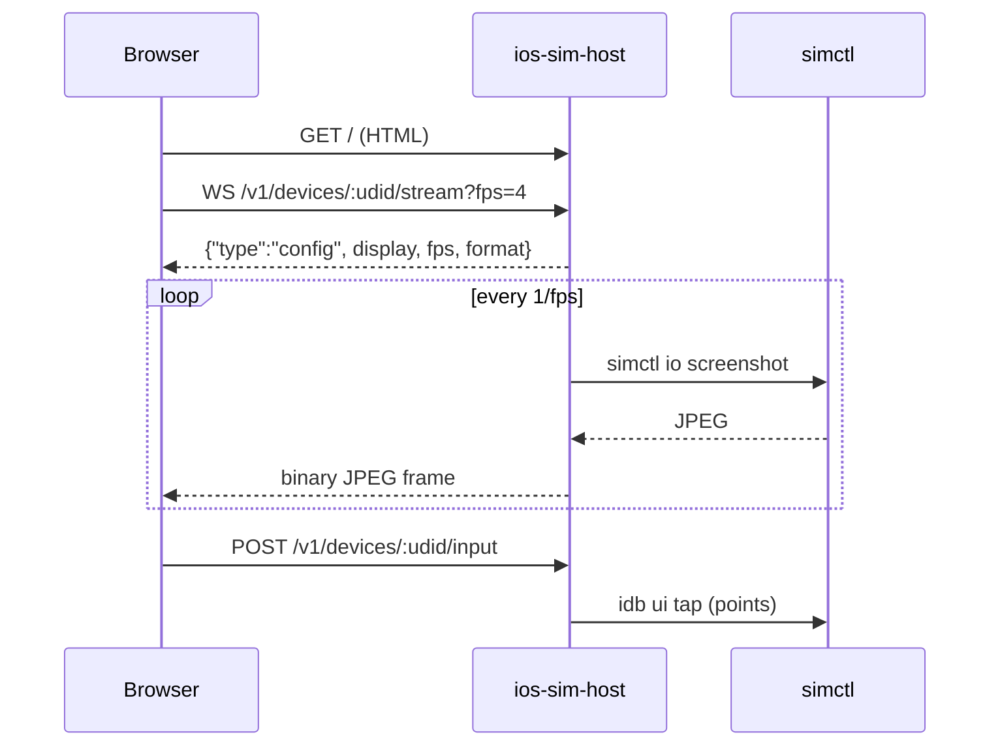

---

title: Browser viewer
sidebar_position: 4
description: Use the built-in Linux-friendly simulator viewer.
---

# Browser viewer

The host serves a small single-page viewer at `/`. It is designed for Linux workstations that do
not have Xcode, and it needs nothing beyond a browser.

## Open it

```bash
ios-sim open
```

This opens:

```text
http://<host>:7777/?token=<token>&device=<udid>
```

You can also paste the URL into any browser. If the token is not in the URL, the page shows an
access-token prompt. The token is stored in `sessionStorage`, not `localStorage`, so closing the
tab ends the session.

## Controls

| Control                   | Action                                                       |
| ------------------------- | ------------------------------------------------------------ |
| Device picker             | Switch between simulators; remembers the last choice per tab |
| Screen                    | Click = tap; drag = swipe                                    |
| Text field + Send         | Type into the focused field on the simulator                 |
| Home / Lock / Side / Siri | Hardware buttons (requires `idb`)                            |
| Show logs                 | Opens an SSE log stream                                      |
| Reconnect                 | Re-opens the WebSocket after a network change                |
| Refresh                   | Re-fetches the device list and reconnects                    |

Coordinates are normalized from the image rectangle, so resizing the browser does not break
input. The server converts normalized coordinates to device points before calling `idb`.

## How the stream works



The default viewer FPS is 4; the host caps at 10. Each frame is a full JPEG (~370–430 KB on an
iPhone 16 Pro at 1206 × 2622), so a 4 fps stream is roughly 1.5–1.7 MB/s. Use 2 fps on slow links.

## Capabilities and limits

- **View-only without `idb`.** The screen and logs still work; input returns 501.
- **No audio.** Audio is a future feature.
- **2–4 fps, not 60.** Polling `simctl` costs ~0.36 s per frame. H.264/WebRTC is Phase 3.
- **No clipboard integration yet.**
- **No multi-user isolation.** Anyone with the token can control the host's simulators.
- **Token in URL.** It can appear in browser history or proxy logs. Prefer the prompt, or use an
  SSH tunnel and a short-lived token (planned).

## Security notes

- Serve over loopback or a private network; use SSH tunnels or TLS.
- Do not share the URL with the token in chat or tickets.
- Rotate the token if it leaks: stop the host, delete `~/.config/ios-sim/token`, restart.
- The viewer is same-origin with the API; there is no CORS relaxation.
- Uploaded app bundles are untrusted input; the host extracts them into a temp directory and
  enforces a size limit.

## When the viewer is black

1. `ios-sim doctor` — is the host reachable and the device booted?
2. Try `ios-sim screenshot /tmp/check.jpg` — does capture work outside the browser?
3. Check the browser console/network tab for a failed WS upgrade.
4. If the host is behind a proxy, allow WebSocket upgrades and disable response buffering.
5. Check the host log for `simctl` errors (device shut down, runtime removed).

## Why not embed the Simulator window?

Embedding the macOS Simulator window requires ScreenCaptureKit and private HID APIs on the host,
and a macOS-side window server. The bridge intentionally uses `simctl` screenshots so it works
headlessly and has no macOS GUI dependency. A future high-fps mode can use ScreenCaptureKit
without changing the viewer's API contract.
