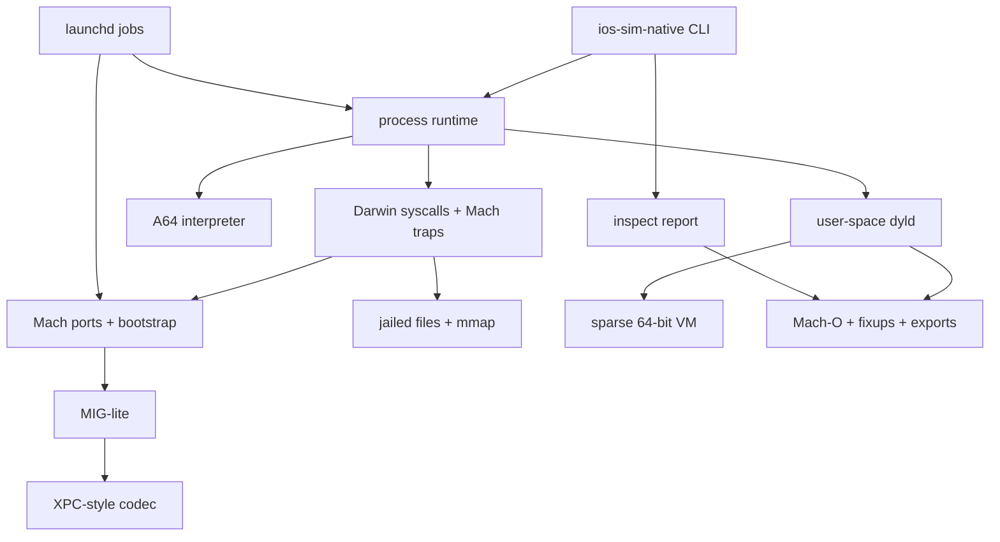

# Layer architecture

The implementation is a stack of independently testable layers. The rule is simple: a layer may
depend on the layer below it, never on the one above. The CLI is the only component that knows
all of them.

## 1. Mach-O (`macho/`)

**Responsibility:** turn bytes into an immutable description plus fixup operations.

- `parse.ts` validates the header, every load command, segment/section bounds, symbol table,
  UUID, build version, entry command, and link-edit payloads.
- `fixups.ts` decodes `LC_DYLD_CHAINED_FIXUPS` into a list of binds and rebases. It never writes
  memory. Chain strides are in 4-byte units and are validated for cycles and bounds.
- `exports-trie.ts` walks the radix tree with depth/node/offset limits and returns typed exports.
- `build.ts` is a minimal writer used by tests and the demo. It does not link; it emits one
  `__TEXT`, one `__DATA`, one `__LINKEDIT`, an optional dependency, exports, and chained fixups.

**Tested by:** parser tests for valid/truncated/corrupted images, fat selection, chained fixups,
and symbol-table fallback. The writer is exercised by every end-to-end test, so a format bug
shows up as a load failure rather than a silent fixture mismatch.

**Why immutable?** The loader can retry or inspect an image without side effects, and the CLI can
show a binary without mapping it.

## 2. Virtual memory (`dyld/vm.ts`)

**Responsibility:** a sparse 64-bit address space with 16 KiB pages.

- Pages live in a `Map<bigint, Uint8Array>`; a 512 MiB budget bounds a process.
- Reads/writes are checked. An unmapped access is a `memory_fault`, never a zero page.
- Fixed mappings reserve image segments; `allocate` skips over them so the heap cannot overwrite
  a slid dylib.
- Permissions are recorded for inspection. The host CPU never executes guest pages, so this is
  bookkeeping, not an MMU.

## 3. AArch64 (`arm64/`)

**Responsibility:** execute the integer subset needed by simple Darwin user-space code.

Implemented: PC-relative addressing, add/sub (immediate, shifted, extended), logical
(immediate/shifted), move-wide, bitfield, extract, conditional compare/select, multiply/divide,
shifts, bit operations, loads/stores (unsigned, unscaled, pre/post, register offset, pair,
literal), branches, `SVC #0x80`, `NOP`, and hint/PAC no-ops.

Not implemented: SIMD/FP, atomics/exclusives, privileged registers, pointer-authentication
enforcement, and 128-bit pairs. These raise `unsupported_instruction` with the PC and encoding,
so a gap is always visible.

**Budget:** the runtime enforces both instruction count and wall-clock deadline. A runaway loop
cannot hang the CLI.

**Tested by:** unit tests for arithmetic, flags, branches, loops, pair/offset memory, PC-relative
addressing, call/return, W-register zero-extension, syscall carry semantics, and unknown
instructions.

## 4. Mach IPC (`mach/`)

**Responsibility:** the semantics, not the kernel ABI.

- A task owns a name table. A name points at a port plus one or more rights (`send`, `receive`,
  `send-once`). Special names `1` (task self) and `2` (bootstrap) are seeded at task creation.
- `machReplyPort` creates a receive+send port. A message can carry the reply port with
  `msgh_local_port`; the receiver gets a send right under a new local name.
- A port either has an in-process handler (synchronous) or a FIFO queue with a depth limit.
- `bootstrapPort` is a normal port with a service registry: register, lookup, list.
- `message.ts` encodes the 24-byte header and a bounded MIG-lite body codec.
- `mig.ts` adds typed client/server calls with a status word.

**Not implemented:** port sets, notifications, memory/port descriptors in transit, QoS,
dead-name resurrection, and true blocking receive. An empty receive returns
`KERN_RECEIVE_TIMED_OUT` even for an infinite timeout because there is no scheduler.

**Tested by:** rights enforcement, reply routing, queue depth, handler replies, service
registration, MIG success/unknown-routine paths, and an interpreted program that sends a message
to the bootstrap port and validates the reply.

## 5. XPC (`xpc/`)

**Responsibility:** a typed object model and request/reply RPC over Mach.

- Values: null, bool, int64/uint64 (as `number` or `bigint`), double, UTF-8 string, data,
  UUID, date, array, dictionary.
- The codec is versioned and bounded (8 MiB, depth 64, one million elements). It rejects
  prototype-polluting keys and trailing bytes.
- `XpcConnection` creates a reply port per call, sends an envelope, validates the reply id/kind,
  and returns the payload. `XpcServer` dispatches requests and turns handler exceptions into an
  `{ $error }` payload.
- `createXpcService` registers a named service with the bootstrap port.

The wire format is **not** Apple's XPC encoding. It is documented in the [ABI page](./abi.md) and
exists so the transport can be tested before a byte-compatible encoder is attempted.

## 6. dyld (`dyld/loader.ts`)

**Responsibility:** map, link, and choose an entry point.

Load order per image: read → parse → choose base/slide → map segments → collect exports →
load dependencies → apply fixups.

- Dependencies support absolute paths, `@loader_path`, `@executable_path`, `@rpath`, weak
  imports, and search paths.
- A base is chosen at the preferred VM address or slid by whole 4 GiB steps when it collides.
  Fixups, exports, and symbol values use the chosen base.
- Bind ordinals: `0` self, `1..n` dependency, `-1` main executable, `-2` flat lookup,
  `-3` weak flat lookup. Special ordinals follow Apple's chained-fixup constants.
- Missing non-weak symbols fail with `symbol_not_found`; weak lookups produce a null pointer.

**Not implemented:** shared cache, executable lazy-stub trampolines, general weak-definition
coalescing, initializers, `dlopen`, two-level namespace enforcement beyond ordinals, and
code-signing validation. Legacy `LC_DYLD_INFO` rebase/bind, lazy, and weak streams are decoded
(LDR-001/002); threaded bind streams remain unsupported.

**Tested by:** entry selection, cross-image chained binds, sliding, dependency errors, and
execution of the resulting program.

## 7. Syscalls (`syscall/`)

**Responsibility:** Darwin BSD syscalls and negative Mach traps for one task.

- Numbers come from the macOS SDK (`sys/syscall.h`) and libsyscall stubs (`x16 = -31` for
  `mach_msg_trap`).
- File descriptors 0/1/2 are stdin/stdout/stderr. Other descriptors are host files confined to
  the root directory.
- `open` maps Darwin flags to host flags explicitly; offsets are tracked per descriptor so `dup`
  shares a file description.
- Anonymous and file-backed `mmap` are supported; `MAP_FIXED` is supported only with an address.
- `gettimeofday`, `getentropy`, uid/gid, pid, `access`, `mkdir`, `unlink`, `dup`, and `dup2`
  are implemented.
- Unimplemented calls are `ENOSYS` in lenient mode and a hard error in strict mode (the default).

**Tested by:** write/read, open/seek/close, creation, path-escape rejection, mmap/unmap, time,
pid/exit, unknown syscalls, and `EBADF`.

## 8. launchd (`launchd/`)

**Responsibility:** a deterministic job supervisor for XML plists.

- Parses `Label`, `Program`, `ProgramArguments`, `EnvironmentVariables`, `RunAtLoad`,
  `KeepAlive`, `MachServices`, `ThrottleInterval`, `WorkingDirectory`, and stdout/stderr paths
  (the latter are recorded but not streamed yet).
- Registers all `MachServices` on a host task before boot.
- Runs `RunAtLoad` jobs sequentially, captures output, records state, and retries failed
  `KeepAlive` jobs up to a bounded budget.
- `start(label)` runs a job on demand; duplicate labels are rejected.

**Not implemented:** sockets, on-demand launch, `launchd_sim`, sessions, watchdog, jetsam,
event streams, and true parallel scheduling.

**Tested by:** manifest parsing, invalid fields, boot, service registration, KeepAlive restart
budget, on-demand start, duplicates, and captured output.

## 9. Runtime (`runtime/process.ts`)

**Responsibility:** compose one process without leaking layer details.

1. Create a Mach task.
2. Create a private sparse address space and load the program.
3. Allocate the stack and write argv/envp strings and pointer tables.
4. Reset the CPU; seed `x0=argc`, `x1=argv`, `x2=envp` (documented compat entry ABI).
5. Execute until exit, budget exhaustion, or a fault.
6. Return stdout/stderr, exit status, instruction count, load statistics, and unsupported
   syscall counts.

## Native kernel boundary (`packages/darwin-host`)

KRN-001..005 move tasks, names, rights, queues, blocking receive, timeouts, interruption, and
bootstrap services into a C11 library loaded through Bun FFI. THR-001 adds thread lifecycle
objects and native thread ports; guest CPU scheduling is still above this boundary. There is no second protocol: the
TypeScript binding calls the C host directly. The ABI is versioned and bounded. It is not a Mach
kernel yet; port sets, descriptors, memory objects, MIG vectors, traps, and the scheduler remain
open. See the [host ABI](./host-abi.md) and
[ADR 0007](../adr/native-kernel-boundary.md).

## UI spike (`packages/uikit-native`)

`UI-000` is deliberately outside the layer stack above. It is a C11 host-side spike that proves a
clean-room UIKit-shaped object model can render a blank window through a native X11 surface
(software ARGB, no web view). It does not use Metal, IOSurface, Apple UIKit, or the guest
Mach-O/runtime path, and it does not satisfy UI-G1. See
[Native UIKit window spike](./uikit-window.md).

## Design invariants

1. **No Apple binaries in the repository.** Tests generate Mach-O files; the optional integration
   builds one from our own assembly on macOS.
2. **No silent success.** Unsupported instructions, bindings, syscalls, flags, and pointer formats
   have stable error codes or explicit counters.
3. **Bounded everything.** Memory, message size, queue depth, image count, fixup count, string
   length, plist depth, XPC depth, instruction count, and wall-clock time.
4. **A jailed filesystem.** Guest paths cannot escape the configured root.
5. **Deterministic tests.** No sleeps, no concurrency, no host timing in assertions except the
   real-clang smoke test.
6. **Layer tests can run on Linux.** The only macOS-gated test builds a real Mach-O with clang
   and prints why it is skipped elsewhere.
