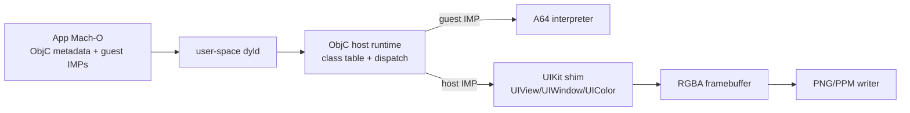

# UIKit proof of concept

This page is the plan of record for the proof of concept that follows the substrate: **an
Objective-C application, produced by a real compiler, creates a view hierarchy and renders a frame
on Linux without macOS.**

It is deliberately narrower than "run an iOS app". Read [limitations](./limitations.md) first: the
simulator, the Apple runtime, UIKit, Metal, and CoreSimulator are still absent.

## What "proof" means here

| Claim           | Evidence                                                                                                   |
| --------------- | ---------------------------------------------------------------------------------------------------------- |
| Objective-C ABI | A Mach-O image with `__objc_classlist`, `class_ro_t`, method lists, and selectors is parsed and dispatched |
| Message send    | `objc_msgSend` trampolines resolve selectors against parsed class metadata and tail-call guest IMPs        |
| Framework shim  | `UIApplicationMain`, `UIWindow`, `UIView`, `UIColor` exist as host-backed classes with real metadata       |
| Rendering       | A view tree is composited into an RGBA framebuffer and encoded as a deterministic PNG                      |
| Real toolchain  | The same app source compiled by clang on macOS passes the same assertions (gated test)                     |

The framework shim is **not** Apple's UIKit. It is a clean-room, documented subset that exists to
prove the ABI and the pipeline. The page states that everywhere the word "UIKit" appears.

## Non-goals

- SpringBoard, `launchd_sim`, CoreSimulator, the dyld shared cache, Apple binaries.
- Real UIKit, Foundation, Metal, IOSurface, CoreAnimation.
- Threads, a real run loop with external event sources, gesture recognisers, multitouch.
- Core Animation, CoreGraphics, CoreText, Metal, and host windows. The shim has a scripted event
  loop, a 3x5 bitmap font, and a software framebuffer instead.
- Exact ARC: retain/release update refcounts, pools drain, and weak slots zero, but zero-count
  objects are never reclaimed (the process is short-lived).

## Architecture



Three new layers:

1. `objc/` parses Apple-ABI metadata from a loaded image (absolute and relative method lists),
   owns the selector/class tables, allocates instances, and implements the runtime entry points
   that ARC and message sends need.
2. `objc/host.ts` builds the framework shim as genuine Mach-O-style metadata allocated in guest
   memory, with IMP trampolines that trap into the host. `_OBJC_CLASS_$_UIView` is a real class
   object, not a special case in the loader.
3. `ui/` renders `UIView` instances from the shim into a framebuffer and writes PNG/PPM.

### Why host-side dispatch

Running the real `libobjc2` would need threads, atomics, TLS, and a Mach-O build of the runtime
before the first message send. The PoC instead implements the ABI **semantics** in TypeScript and
keeps the boundary explicit:

- `objc_msgSend` is bound to a generated trampoline (`movz/movk x16; svc #0x80; ret`).
- The trap either calls a host IMP or sets `pc` to the guest IMP, preserving the caller's
  argument registers and return address (a true tail call).
- Every host IMP address is a real trampoline, so metadata stays valid for inspection and for
  future guest-side calls.

This is the same "semantic model first, native boundary later" decision as the substrate, and it
is recorded in ADR 0007.

## Gates

| Gate         | Acceptance                                                           | Status      | Evidence                                               |
| ------------ | -------------------------------------------------------------------- | ----------- | ------------------------------------------------------ |
| P0 FP/SIMD   | clang-shaped code using doubles for `CGRect` executes                | implemented | `arm64/cpu.test.ts` vector/FP cases                    |
| P1 metadata  | class list, absolute + relative method lists, selectors, ivars size  | implemented | `objc/host.test.ts`, `tests/native/objc-clang.test.ts` |
| P1 dispatch  | `objc_msgSend`/`objc_msgSendSuper2`, `+alloc`, host + guest IMPs     | implemented | guest `+alloc` override test, clang app                |
| P1 lifecycle | refcounts, autorelease pools, weak zeroing, guest `-dealloc`         | implemented | `abi.md`, `limitations.md`                             |
| P2 shim      | `UIApplicationMain` → delegate callback → window/view/colour         | implemented | `objc/host.test.ts`                                    |
| P2 frame     | deterministic PNG frame, bounded frames, no host graphics dependency | implemented | `ui/framebuffer.test.ts`, `uikit-demo`                 |
| P2 input     | taps, drags, ticks, control actions, timers, legacy animations       | implemented | `objc/host.test.ts`                                    |
| P2 text      | 3x5 bitmap labels, wrapping, line limits; PNG images from resources  | implemented | `objc/host.test.ts`, `ui/png.test.ts`                  |
| P3 compiler  | clang-built ObjC app renders the same frame (macOS-gated)            | implemented | `tests/native/objc-clang.test.ts`                      |

"implemented" means tested in this repository and reproducible with the commands below. It does
not mean the gate after it is reachable.

### Current evidence

The generated fixture and the clang fixture both render:

```text
frame 375x667 sha256=<deterministic>
```

The digest is not pinned as a constant: it changes whenever the fixtures change. Instead the
hermetic test asserts pixel properties and the gated clang test asserts that the two independent
producers (this repository's writer and Apple clang) produce the **same** digest sequence for
taps, drags, ticks, the button, the switch, the slider, and nested views, including timer fires and
the animation timeline during ticks. A change in either path breaks the equality,
which is the point.

With `--tap 30,30` the same app renders three frames: red, blue after `touchesBegan:`, green after
`touchesEnded:`. A drag adds yellow `touchesMoved:` samples. Both producers are compared on the
full digest sequence.

## Try it

```bash
bun install --frozen-lockfile
bun run --cwd packages/darwin-compat build

# generated ObjC app: class metadata, message sends, shim, frame
bun apps/native/src/bin.ts uikit-demo --out /tmp/uikit-demo.png
bun apps/native/src/bin.ts uikit-demo --tap 30,30 --out-dir /tmp/frames
bun apps/native/src/bin.ts uikit-demo --drag 30,30,60,60,3 --out-dir /tmp/drag
bun apps/native/src/bin.ts uikit-demo --tick 4 --out-dir /tmp/ticks

# the demo's UIImageView loads this 8x8 fixture PNG from the fixture directory
bun scripts/make-fixture-image.ts

# optional: the same pipeline with clang output (macOS + Xcode)
./scripts/build-objc-fixture.sh
bun apps/native/src/bin.ts inspect fixtures/objc-window/build/ObjcWindow --objc
bun apps/native/src/bin.ts inspect fixtures/objc-window/build/ObjcWindowLegacy --json
bun apps/native/src/bin.ts run fixtures/objc-window/build/ObjcWindow --tap 30,30 --out-dir /tmp/clang
```

### Why the clang build needs stubs

ld64 refuses to link a dynamic executable without libSystem, and the compatibility layer must not
open an Apple binary. `scripts/build-objc-fixture.sh` therefore generates two tiny dylibs:

- `libSystem.dylib` satisfies the link (install name `/usr/lib/libSystem.B.dylib`, self-dependency
  so ld64 accepts it);
- `libSystemShim.dylib` is what the executable actually loads, after
  `install_name_tool -change` rewrites the load command to `@loader_path/libSystemShim.dylib`.

Both export nothing. Every ObjC symbol the app imports (`objc_msgSend`, `objc_alloc`,
`_OBJC_CLASS_$_UIView`, …) is resolved by `ObjcHost.symbols`. The fixture links with
`-fixup_chains` and `-no_fixup_chains` variants; both run through the same loader and render the
same frames. The legacy variant exercises the classic `LC_DYLD_INFO` opcode path.

A caveat from the stub link: ld64 cannot see `UIView`'s layout, so the clang fixture's
`instanceSize` is its own ivar size (1) and the ivar offset is a symbol address rather than 8.
The class metadata is still parsed and conformance still works, but only the generated fixture
has compiler-resolved layout. The gated test therefore asserts metadata presence and frame
equality, not ivar offsets. A real app linked against a real UIKit would have both.

## Reading the evidence

- `packages/darwin-compat/src/objc/abi.ts` — metadata parser.
- `packages/darwin-compat/src/objc/host.ts` — dispatch, shim classes, trampolines.
- `packages/darwin-compat/src/objc/build-ui-demo.ts` — the generated app fixture.
- `packages/darwin-compat/src/ui/framebuffer.ts` — PNG/PPM encoding.
- `tests/native/objc-clang.test.ts` — the gated real-compiler test.

## Open problems (in order)

1. Lazy class realisation and exception handling.
2. Threads and blocking receives; the loop is a scripted list of taps/drags/ticks, not an event
   source.
3. A real allocator/deallocator and exact ARC semantics.
4. Compiler-resolved layout for the clang fixture (the stub libSystem link leaves superclass
   layout unresolved).
5. CoreGraphics paths, text, and a window on the host.
6. Metal/IOSurface and the Apple runtime — still the multi-year blockers.
