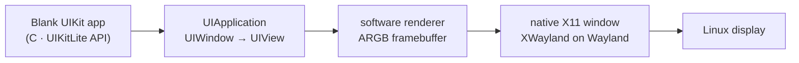

# Native UIKit window spike

This spike answers a narrow question: can a UIKit-shaped application open a **native window** on
Linux through our own code, without a browser, web view, Apple binary, or Apple framework?

Yes — for a blank window. It is not Apple UIKit, and it does not satisfy the UI gate. It is a
clean-room **UIKit-compatible subset** (`UIKitLite`) with a software renderer and an X11 backend.

:::warning What this is not
This does not run Apple's UIKit, an iOS `.app`, UIKit's private frameworks, Metal, IOSurface,
CoreAnimation, or SpringBoard. It is a native translation of the small API shape needed for a
blank window. Apple UIKit still requires the licensed runtime and the phases in the
[roadmap](./roadmap.md); this spike does not change those gates.
:::

## Architecture



There is no HTTP server, HTML, canvas, WebView, Electron, or browser dependency in this path.
`bun run test:uikit` builds a Linux image with Bun + X11, launches `ios-sim-native window`, and
inspects the resulting X11 window with `xdotool` and ImageMagick. The window is a native X11
client; the CLI only locates and spawns it.

## What the API implements

| UIKit-shaped API              | Current behaviour                               |
| ----------------------------- | ----------------------------------------------- |
| `CGRect`, `CGPoint`, `CGSize` | geometry primitives                             |
| `UIColor`                     | RGBA colour, hex helper, alpha                  |
| `UIView`                      | frame, background, alpha, hidden, children      |
| `UIViewController`            | owns a root view                                |
| `UIWindow`                    | title, root view controller, key-window state   |
| `UIApplication`               | window list, key window, run loop               |
| `UIApplicationDelegate`       | did-finish-launching / will-terminate callbacks |
| `UIKitRender`                 | software ARGB render with clipping and alpha    |
| X11 host                      | map, expose, resize, Escape/close, title        |

The object model and renderer are C11; there is no Objective-C runtime yet. The API shape is
familiar, the implementation is ours.

## Build and run on Linux

```bash
# Debian/Ubuntu build dependencies
sudo apt-get install build-essential libx11-dev pkg-config

bun run build:uikit
bun apps/native/src/bin.ts window --width 402 --height 874 --color 1e1e2e
```

Or run the binary directly:

```bash
packages/uikit-native/build/uikit-window \
  --width 402 --height 874 --color 1e1e2e \
  --title "UIKitLite Blank Window"
```

The process opens a native X11 window and prints:

```text
uikit: window ready 402x874
```

Wayland desktops need XWayland and a valid `DISPLAY`. A native Wayland backend is a future task,
not a hidden dependency.

## Verify without a desktop

```bash
bun run test:uikit
```

That command builds a Linux image, compiles the C library and example, starts Xvfb, runs
`ios-sim-native window`, and asserts:

- the CLI spawns a native X11 window with the requested title;
- geometry is `402x874`;
- pixel `(10,10)` is `srgb(30,30,46)` (`0x1e1e2e`);
- resizing to `320x480` still renders the background;
- the software object-model unit test passes.

No web view is involved.

## Example app

```c
#include "uikit.h"

static void did_finish_launching(UIApplication *application) {
  UIWindow *window = UIApplicationCreateWindow(
      application, CGRectMake(0, 0, 402, 874));
  UIWindowSetTitle(window, "UIKitLite Blank Window");

  UIViewController *controller = UIViewControllerCreateWithView(
      UIViewCreate(CGRectMake(0, 0, 402, 874)));
  UIViewSetBackgroundColor(UIViewControllerGetView(controller), UIColorHex(0x1e1e2e));

  UIWindowSetRootViewController(window, controller);
  UIWindowMakeKeyAndVisible(window);
}

int main(void) {
  UIApplicationDelegate delegate = {
      .applicationDidFinishLaunching = did_finish_launching,
  };
  return UIApplicationMain(&delegate);
}
```

## What this proves

- A native window opens on Linux from our own code path.
- A UIKit-shaped object model can be rendered without a web view.
- The renderer is deterministic enough to test by pixel inspection.
- The host boundary can be exercised on a headless CI runner.

## What this does **not** prove

- Apple UIKit compatibility. The class names are similar; the ABI and private SPI are not
  implemented.
- A compiled iOS app can run. There is no ObjC/Swift runtime, Foundation, Metal, or CoreSimulator
  in this path.
- Metal/IOSurface/CoreAnimation fidelity.
- Text, controls, accessibility, touch input, or lifecycle beyond open/resize/close.
- That UI-G1 is passed. The gate still requires a UIKit app, rendering, input, and accessibility
  in the real compatibility stack.

## Roadmap position

`UI-000` is an **out-of-order vertical spike**, recorded in the
[backlog](../roadmaps/native/backlog.md). It de-risks the host window and software renderer while
the critical path remains `KRN-001` (native boundary) and the loader/runtime phases. The next UI
work remains `UI-001` (UIKit surface inventory) after the graphics/runtime gates.

## Source layout

```text
packages/uikit-native/
  include/uikit.h          public UIKitLite API
  src/uikit.c              object model + software renderer
  src/uikit_x11.c          native X11 event loop and present
  examples/blank_window.c  blank-window app
  tests/test_uikit.c       renderer/object-model tests
  tests/x11-cli-smoke.sh   Xvfb + CLI integration test
infra/uikit-cli/Dockerfile Linux Bun + X11 test image
scripts/build-uikit-native.sh
scripts/test-uikit-linux.sh
```
