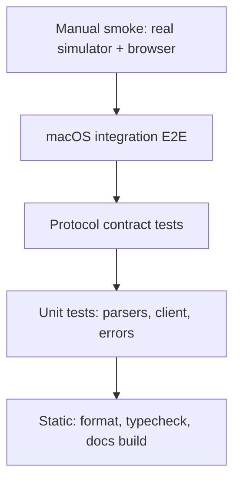

# Testing strategy

The cross-cutting quality roadmap is [Engineering quality](../roadmaps/engineering-quality.md).
This page defines the bridge-specific test matrix and fixtures.

The hard part of testing this project is the platform split: the host needs macOS and Xcode, but
the client must be proven on Linux. The strategy is therefore built around a **fake host** for
fast feedback and a **real simulator** for fidelity.

## 1. Test pyramid



| Layer             | What it proves                                      | Runtime            | Speed           |
| ----------------- | --------------------------------------------------- | ------------------ | --------------- |
| Static            | Types, formatting, broken links                     | Any                | Seconds         |
| Unit              | Parsers, validation, coordinate math, error mapping | Any                | Milliseconds    |
| Contract          | Host HTTP/WS behaviour against the shared schemas   | Any (mock backend) | Seconds         |
| Linux E2E         | A Linux container can use the CLI against a host    | Linux container    | Tens of seconds |
| macOS integration | Real `simctl`/`idb` produce the expected behaviour  | macOS + Xcode      | Minutes         |
| Manual smoke      | Human-visible stream and input                      | macOS + browser    | Minutes         |

## 2. Test environments

| Environment      | Purpose                               | Requirements                                 |
| ---------------- | ------------------------------------- | -------------------------------------------- |
| Developer laptop | Fast unit/contract tests              | Bun 1.4.4+                                   |
| Linux container  | Proves the client is Linux-compatible | Docker/OrbStack, Bun image                   |
| macOS host       | Real simulator integration            | macOS, Xcode 27+, iOS runtime, booted device |
| CI Linux runner  | Unit/contract/E2E/docs                | Bun, Docker not required for unit            |
| CI macOS runner  | Integration                           | Xcode installed; runtime available           |

The project's CI target is a Linux job on every push and a macOS integration job before release.
Phase 1 validates both locally; Phase 2 wires the CI.

## 3. What is tested where

| Requirement                  | Unit    | Contract | Linux E2E | macOS E2E |
| ---------------------------- | ------- | -------- | --------- | --------- |
| Device list/runtimes parsing | ✓       | ✓        | ✓         | ✓         |
| Boot/shutdown/erase/delete   |         | ✓        |           | ✓         |
| Screenshot PNG/JPEG          |         | ✓        | ✓         | ✓         |
| Display metadata and scale   | ✓       | ✓        |           | ✓         |
| Normalized input/tap         | ✓       | ✓        | ✓         | ✓         |
| Install `.app` tarball       | ✓ (tar) | ✓        |           | ✓         |
| Launch/terminate             |         | ✓        |           | ✓         |
| Logs SSE                     |         | ✓        |           | ✓         |
| Token auth                   |         | ✓        | ✓         |           |
| Error mapping                | ✓       | ✓        |           |           |
| Streaming WS frames          |         | ✓        | ✓         | ✓         |
| Docs links                   |         |          |           | static    |

## 4. Unit tests

### Protocol

- Zod schemas accept valid payloads and reject out-of-range input coordinates.
- `IosSimClient` builds correct URLs, adds auth, parses errors, handles 204.
- Device resolution: `booted` with zero/one/multiple devices; UDID and name matching.
- Stream/log URLs: scheme conversion (`http`→`ws`), token query, FPS/format.

### Host

- `parseDevices` maps runtime identifiers to labels, sorts, and preserves unknown states.
- `parsePid` handles real `simctl launch` output and rejects garbage.
- `compareVersions` orders `26.4.1` above `26.4`.
- `runtimeLabel` formats identifiers.
- Error mapping: `SimctlError` → 502, input unavailable → 501, Zod → 400.
- Coordinate conversion: points/pixels/normalized, bounds checks.
- Tar upload: missing `.app` rejected; valid bundle found; traversal filtered.

### CLI

- Common option merging (global vs subcommand), env fallback, token file fallback.
- `tap` unit conversion for a 3× display.
- Table output widths and empty states.

## 5. Contract tests

`buildServer({ backend: new MockBackend(), token })` is started with Fastify's `inject` or a real
ephemeral listener. Tests cover:

| Area       | Cases                                                                    |
| ---------- | ------------------------------------------------------------------------ |
| Auth       | Missing token → 401; wrong token → 401; query token on WS; health public |
| Devices    | List, create, boot, shutdown, erase, delete; 404s                        |
| Apps       | List; install gzip tar; reject empty/oversized/non-app; launch/terminate |
| Display    | Metadata includes px, points, scale; format default                      |
| Screenshot | Content type; non-empty bytes; format validation                         |
| Input      | Tap/swipe/text/key/button; bounds; unavailable → 501                     |
| Logs       | SSE headers; data frames; stream close                                   |
| Stream     | WS config message; binary frame; invalid token closes 1008               |
| Errors     | Unknown route 404; malformed JSON 400; simctl failure 502                |

The mock backend is deterministic: fixed devices, 1×1 JPEG/PNG, recorded inputs, and two log
lines. It is also useful for demos on Linux (`--backend mock`).

## 6. Linux E2E

`scripts/test-linux.sh` builds `infra/linux/Dockerfile` and runs `scripts/linux-e2e.sh` inside
the container. The script:

1. Starts the host with `--backend mock --token test-token` on port 7788.
2. Runs `ios-sim doctor`, `devices`, `screenshot`, `tap`, `install`, `launch`, `apps`, `logs`.
3. Asserts JSON output and exit codes.
4. Verifies that an unauthenticated request fails.

This proves the CLI, protocol client, and Bun runtime work on Linux without macOS libraries.

The Docker image copies only this repository; there is no Xcode and no Apple binary in it.

## 7. macOS integration E2E

Gated by `IOS_SIM_MACOS_TESTS=1` so `bun run test` remains fast and portable.

Prerequisites:

- macOS with Xcode and at least one iOS runtime.
- A booted simulator (the test can boot one by UDID/name).
- `idb` optional; input tests skip with a clear message when unavailable.
- Accessibility permission may be required for some `idb` operations.

Tests:

1. Start the host with the real `SimctlBackend` on an ephemeral port.
2. `health` reports `backend: simctl` and capability flags.
3. `devices` includes the booted device.
4. `display` reports a positive pixel size and scale.
5. `screenshot` returns a JPEG (magic bytes `FF D8`) or PNG.
6. Build `fixtures/hello-sim` with `scripts/build-fixture-app.sh`.
7. Upload/install/launch the fixture; capture a screenshot while it runs.
8. If `idb` is available: tap the center, type text, press Home, and assert no error.
9. Stream one or two frames over WS.
10. Fetch logs for ~1 second and assert at least one SSE event (best effort; logs can be quiet).

The fixture app is a minimal UIKit app with a label, built for `iphonesimulator` arm64.

## 8. Manual smoke

`scripts/macos-smoke.sh` is the human-facing check:

```bash
./scripts/macos-smoke.sh 7AD86EEA-A3F1-4103-B010-C8264B2AC6C6
```

It starts the host, lists devices, captures a full-size screenshot, opens the browser viewer, and
waits for Ctrl+C. Use it before a release and when validating a new Xcode version.

## 9. Performance tests

Not automated in v0.1; measured with `scripts/measure-macos.sh`:

- 10 screenshot runs (cold + warm).
- 5 tap runs (cold + warm).
- JPEG payload size.
- Derived max polling FPS and bandwidth.
- Optional: concurrent WS clients and memory after 10 minutes.

Targets (LAN, single client):

| Metric        | Target                     | Current                 |
| ------------- | -------------------------- | ----------------------- |
| Tap latency   | < 1 s p95                  | ~0.22 s warm (loopback) |
| Frame age     | < 1 s at 2 fps             | ~0.36 s capture         |
| Host CPU      | < 50% of one core at 2 fps | To be measured          |
| Memory growth | Flat over 30 min           | To be measured          |

Phase 3 will add automated soak tests.

## 10. Security tests

| Test                            | Expected                                                     |
| ------------------------------- | ------------------------------------------------------------ |
| Token missing/wrong on REST     | 401 JSON error                                               |
| Token missing/wrong on WS       | Close 1008                                                   |
| `--no-auth` + `0.0.0.0`         | Process refuses to start                                     |
| Upload a tar with `../` entries | Extraction safe; no file outside temp                        |
| Upload > limit                  | 413                                                          |
| Upload without `.app`           | 400 `app_bundle_missing`                                     |
| Path-like UDID / bundle id      | Treated as an argument, not a shell string; no injection     |
| Logs predicate                  | Length-capped; passed as an argument                         |
| Error responses                 | No stack traces, no host paths unless from `simctl` (review) |

See the [threat model](../security/threat-model.md) for the review checklist.

## 11. Test data and fixtures

| Fixture                         | Purpose                     | Committed?                            |
| ------------------------------- | --------------------------- | ------------------------------------- |
| `fixtures/simctl/devices.json`  | Parser coverage             | Yes                                   |
| `fixtures/simctl/runtimes.json` | Runtime label mapping       | Yes                                   |
| `fixtures/simctl/apps.json`     | App list parser             | Yes                                   |
| `fixtures/hello-sim/`           | Real install/launch fixture | Source + script; build output ignored |
| `MockBackend`                   | Deterministic host          | Code                                  |

Do not commit simulator data, tokens, or screenshots containing personal information.

## 12. Flakiness policy

- Integration tests must not depend on the currently booted device's app state; install and launch
  the fixture explicitly.
- Logs are inherently quiet; assert "stream opens" rather than "specific line appears".
- Input tests skip (not fail) when `idb` is unavailable, and the skip reason is printed.
- Streaming tests use a timeout and close sockets in `finally`.
- Retries are not used to hide flakiness; a flaky test is a bug.

## 13. Commands

```bash
bun run format:check   # bun fmt
bun run typecheck      # tsc, all workspaces
bun run test           # unit + contract, any OS
bun run test:linux     # Docker/OrbStack E2E
bun run test:macos     # real simulator integration
bun run docs:build     # Docusaurus, broken-link check
bun run verify         # all of the above that apply to the host
```

## 14. Native track tests

The Option A substrate has its own pyramid. Every layer is testable without a Mac; the only
macOS-only check compiles a real Mach-O and prints its skip reason elsewhere.

| Layer       | Test file(s)                       | What is proved                                             |
| ----------- | ---------------------------------- | ---------------------------------------------------------- |
| Mach-O      | `src/macho/parse.test.ts`          | valid/truncated/fat images, chained fixups, symbols, tries |
| AArch64     | `src/arm64/cpu.test.ts`            | arithmetic, flags, branches, memory, calls, syscall traps  |
| Mach        | `src/mach/kernel.test.ts`          | rights, replies, queue depth, services, MIG calls          |
| XPC         | `src/xpc/xpc.test.ts`              | codec limits, request/reply, handler errors, timeouts      |
| Syscalls    | `src/syscall/kernel.test.ts`       | jailing, file I/O, mmap, time, pid, strict/lenient errors  |
| Plist       | `src/plist/plist.test.ts`          | all types, entities, duplicates, unsafe keys, depth        |
| launchd     | `src/launchd/launchd.test.ts`      | parsing, services, RunAtLoad, KeepAlive, duplicate labels  |
| dyld + CPU  | `src/dyld/loader.test.ts`          | generated entry, cross-image bind, Mach ping, missing deps |
| Legacy dyld | `src/macho/legacy-fixups.test.ts`  | rebase/bind opcodes, malformed streams, fixture sliding    |
| CLI         | `apps/native/src/cli.test.ts`      | doctor/inspect/run/demo/help/error paths                   |
| Real clang  | `tests/native/macos-clang.test.ts` | a clang-produced arm64 Mach-O runs end-to-end              |

Generated fixtures are built from the repository's own A64 encoder and Mach-O writer. No Apple
binary is committed. The optional clang fixture is compiled into a temporary directory from
`fixtures/darwin-hello/hello.s`; on Linux the test is skipped with a printed reason.

Commands:

```bash
bun run test:native
bun run --cwd packages/darwin-compat build
bun apps/native/src/bin.ts demo
./scripts/build-native-fixtures.sh   # macOS + clang; runs the smoke test
```

Native tests enforce the same discipline as the bridge: deterministic, no sleeps, stable error
codes, and explicit skips rather than hidden failures.
