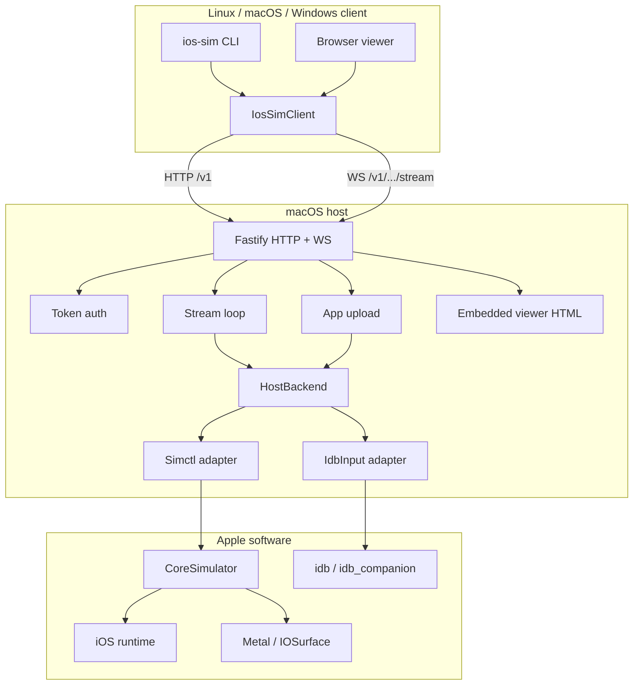
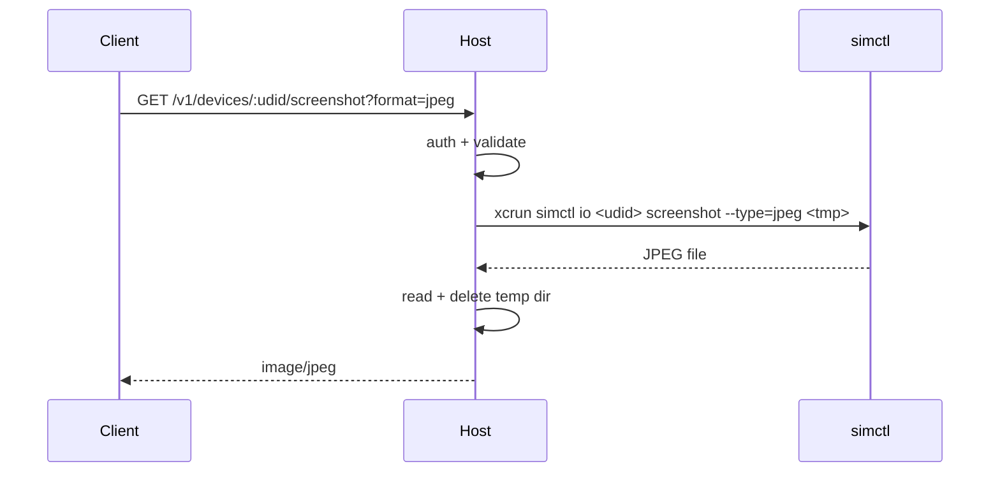
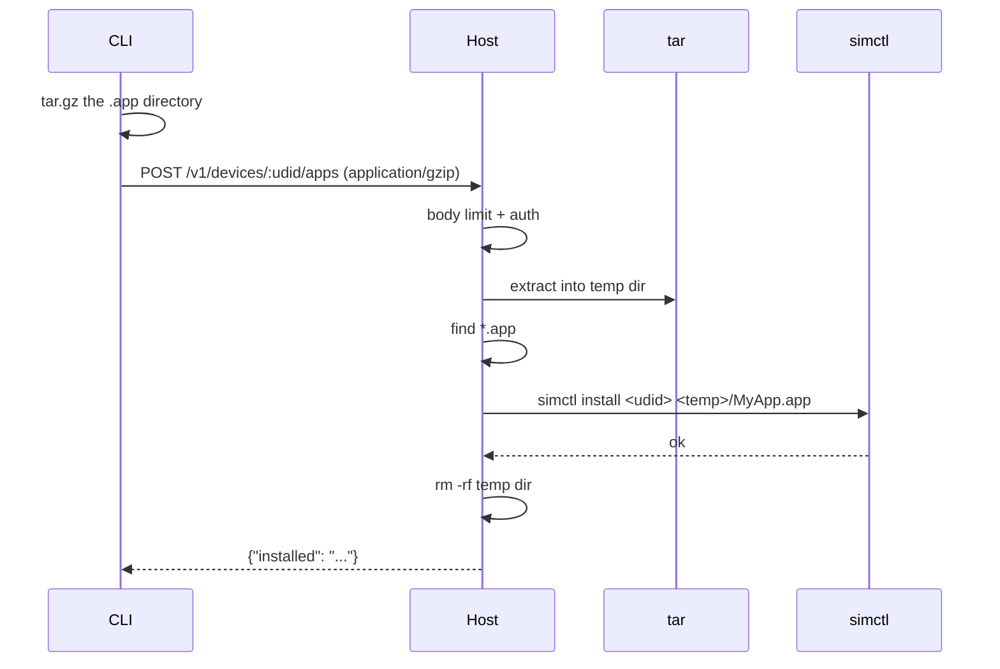
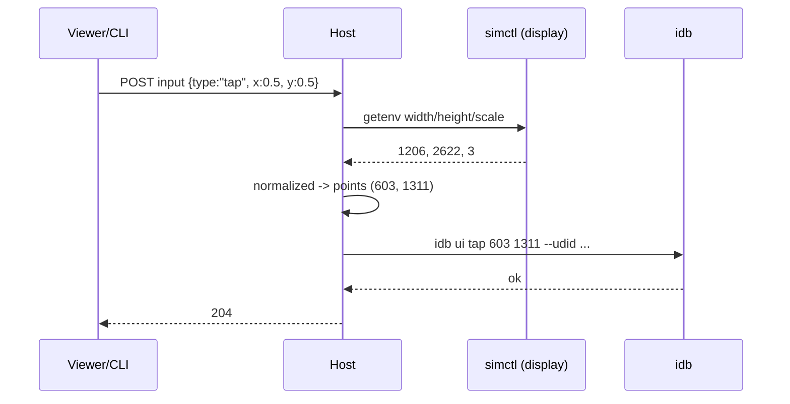
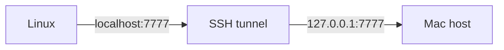
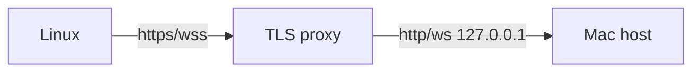
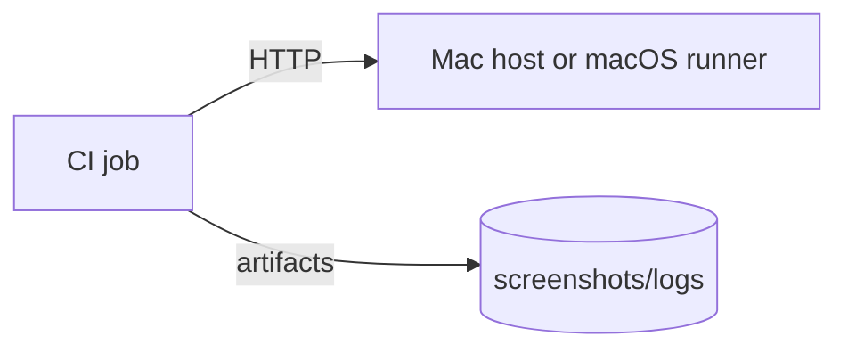

---

title: Architecture
sidebar_position: 1
description: Components, data flows, deployment topologies, and trust boundaries.
---

# Architecture

## 1. Components

| Component           | Responsibility                               | Must not know about                              |
| ------------------- | -------------------------------------------- | ------------------------------------------------ |
| `@ios-sim/protocol` | Schemas, typed client, URL construction      | macOS, `simctl`                                  |
| Host HTTP/WS        | Auth, routing, validation, streaming, errors | Simulator internals beyond the backend interface |
| `SimctlBackend`     | Lifecycle, capture, display, apps, logs      | HTTP                                             |
| `IdbInput`          | HID input                                    | HTTP, device lifecycle                           |
| CLI                 | UX, coordinate conversion, tar packaging     | Apple frameworks                                 |
| Viewer              | Rendering, pointer mapping                   | Apple frameworks                                 |

## 2. Request flow: screenshot

## 3. Request flow: app install

## 4. Input flow

Normalized coordinates are the wire contract. Points/pixels are a client concern.

## 5. Deployment topologies

### A. Loopback + SSH tunnel (recommended)

- Host binds `127.0.0.1`.
- No port exposed beyond SSH.
- Token still required (defence in depth).

### B. Private LAN with TLS

- Proxy terminates TLS and forwards WebSocket upgrades.
- Firewall restricts clients.
- Token required.

### C. CI runner

- The CLI is installed in the job image.
- The host is long-lived, or the job starts `ios-sim-host` on a macOS runner.
- Pin Xcode/runtime/bridge versions.

## 6. Ports and protocols

| Port | Protocol         | Purpose              | Default bind    |
| ---- | ---------------- | -------------------- | --------------- |
| 7777 | HTTP + WebSocket | API, viewer, stream  | `127.0.0.1`     |
| 7777 | SSE              | Logs                 | Same            |
| 22   | SSH              | Tunnel (recommended) | Host SSH config |
| 443  | HTTPS/WSS        | TLS proxy (optional) | Proxy           |

No database, message broker, or external service is required.

## 7. State

| State          | Location                               | Lifetime               |
| -------------- | -------------------------------------- | ---------------------- |
| Token          | `~/.config/ios-sim/token` (0600)       | Until rotated          |
| Client config  | `~/.config/ios-sim/client.json` (0600) | Persistent             |
| Uploaded app   | Host temp dir                          | Deleted after install  |
| Screenshot     | Host temp dir                          | Deleted after read     |
| Simulator data | CoreSimulator device directory         | Managed by Apple/Xcode |
| Stream frames  | Memory / client disk                   | Ephemeral              |

The host is stateless apart from the token file. Restarting it does not reset simulators.

## 8. Failure modes

| Failure             | Effect                            | Recovery                                |
| ------------------- | --------------------------------- | --------------------------------------- |
| `idb` missing       | Input 501; view/install/logs work | Install idb; restart host               |
| `idb` crashes       | Input 502                         | `idb kill`; retry; restart              |
| Simulator shut down | Capture/launch fail               | `ios-sim boot`                          |
| Runtime removed     | Device unavailable                | Reinstall runtime in Xcode              |
| Host restarts       | Clients reconnect                 | `ios-sim open` / retry                  |
| Network drops       | WS closes                         | Viewer reconnects; CLI retries manually |
| Token leak          | Unauthorized control              | Rotate token; audit logs                |
| Disk full           | Install/screenshot fail           | Free space; monitor                     |

## 9. Scaling

v0.1 is one process, one host, no shared capture loop. Each viewer opens its own polling loop.

Phase 2 introduces a per-device capture loop shared by subscribers. Phase 3 adds a real video
pipeline and device scheduling. Scaling beyond one host is a matter of routing clients to hosts
(e.g., a simple registry), not changing the client protocol.

## 10. Why the protocol is small

- No custom binary framing beyond WebSocket messages.
- JPEG is universally decodable; debugging is trivial.
- JSON errors and SSE logs work through proxies.
- Versioned `/v1`; additive changes only.
- The transport seam allows H.264/WebRTC later without breaking lifecycle/input APIs.

See [Protocol](./protocol.md) and [API](./api.md) for the exact contract.
