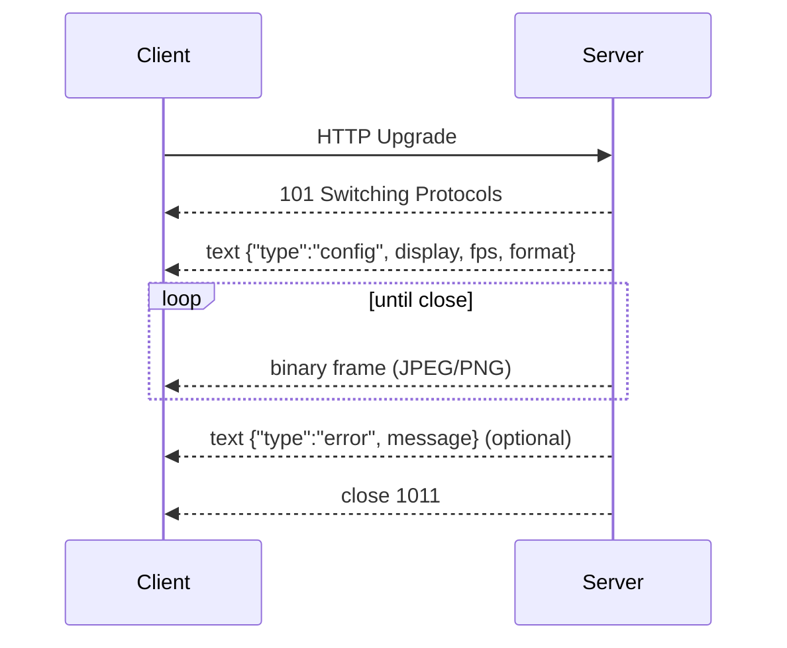

# Protocol

The protocol lives in `packages/protocol` and is shared by the host, CLI, tests, and any future
client. It is deliberately small: JSON over HTTP, binary frames over WebSocket, and SSE for logs.

## 1. Design principles

1. **One source of truth.** Zod schemas define the wire types; TypeScript types are inferred.
2. **Normalized on the wire.** Input coordinates are `0..1`; points/pixels are client concerns.
3. **Capabilities, not assumptions.** Clients read `/v1/health` before assuming input/install.
4. **Additive evolution.** `/v1` gains optional fields; breaking changes become `/v2`.
5. **Boring transports.** JSON, JPEG/PNG, SSE, WebSocket. No custom binary framing.
6. **Errors are data.** Stable codes and human-readable messages; no stack traces on the wire.

## 2. Types

### Device

```ts
interface Device {
  udid: string;
  name: string;
  runtime: string; // display label, e.g. "iOS 26.4"
  runtimeIdentifier: string; // com.apple.CoreSimulator.SimRuntime.iOS-26-4
  deviceTypeIdentifier: string;
  state: string; // Booted, Shutdown, Booting, ...
  isAvailable: boolean;
}
```

### Display

```ts
interface Display {
  widthPx: number;
  heightPx: number;
  scale: number; // 3 on a 3x iPhone
  widthPoints: number; // widthPx / scale
  heightPoints: number;
  format: "jpeg" | "png";
}
```

### InputEvent

```ts
type Point = { x: number; y: number }; // both 0..1

type InputEvent =
  | { type: "tap"; x: number; y: number }
  | { type: "swipe"; from: Point; to: Point; durationMs?: number }
  | { type: "text"; text: string }
  | { type: "key"; key: string }
  | { type: "button"; button: "home" | "lock" | "side" | "siri" };
```

`durationMs` defaults to 300, max 10,000. Text is max 10,000 characters. Key is max 80.

### Health

```ts
interface Health {
  ok: boolean;
  service: "ios-sim-host";
  version: string;
  platform: string;
  backend: "simctl" | "mock" | string;
  hostname: string;
  uptimeSeconds: number;
  capabilities: {
    input: boolean;
    install: boolean;
    logs: boolean;
    streaming: boolean;
  };
  xcode?: string;
}
```

## 3. HTTP

See the [API reference](./api.md) for routes. Protocol-level rules:

- `Content-Type: application/json` for JSON bodies.
- `Content-Type: application/gzip` for app uploads.
- `Accept: image/jpeg` for screenshots (the response type is authoritative).
- `204 No Content` for successful mutations that have no payload.
- `4xx`/`5xx` always carry the error envelope.
- Unknown query parameters are ignored; unknown JSON fields are ignored by Zod object schemas.

## 4. WebSocket stream

URL: `/v1/devices/:udid/stream?fps=2&format=jpeg&token=…`



Rules:

- The first message is always a JSON `config` text frame.
- Frames are binary and independently decodable (no deltas, no shared headers).
- The server does not run concurrent captures per connection; it skips a frame if the previous
  one is still in flight or the buffer is above 4 MiB.
- `fps` is clamped to 1..10; default 2.
- `format` defaults to `jpeg`; `png` is supported for lossless inspection.
- Invalid token: close 1008. Capture/setup failure: close 1011 after an `error` text message.
- Clients must treat frames as opaque bytes and use `Display` for geometry.

## 5. SSE logs

URL: `/v1/devices/:udid/logs?level=info&predicate=…&token=…`

- Each `data:` line is one NDJSON object from `log stream --style ndjson` (or a host error).
- A `: ping` comment is sent every 15 s.
- The server closes the stream when the device shuts down or the client disconnects.
- `predicate` and `level` are passed as arguments to `simctl spawn`, not interpolated into a
  shell.

## 6. Auth

- REST: `Authorization: Bearer <token>`.
- WS/SSE: `?token=<token>` (browsers cannot set headers on the upgrade/EventSource).
- `GET /v1/health` is public so a client can discover capabilities before auth; it exposes no
  device data.
- The token is a shared secret in v0.1; per-user tokens are Phase 3.

## 7. Versioning and compatibility

| Change                         | Allowed in `/v1`?                         |
| ------------------------------ | ----------------------------------------- |
| Add an optional response field | Yes                                       |
| Add an optional request field  | Yes                                       |
| Add a new endpoint             | Yes                                       |
| Add an enum value              | Yes, clients must tolerate unknown values |
| Remove/rename a field          | No (use `/v2`)                            |
| Change coordinate semantics    | No                                        |
| Change auth scheme             | No (new version)                          |

`GET /v1/health` is the capability handshake. A client should check `capabilities.input` rather
than assume 501 vs success.

## 8. Implementing a client

```ts
import { createClient } from "@ios-sim/protocol";

const client = createClient({
  baseUrl: "http://127.0.0.1:7777",
  token: process.env.IOS_SIM_TOKEN,
});

const device = await client.resolveDevice("booted");
const display = await client.display(device.udid);

await client.input(device.udid, { type: "tap", x: 0.5, y: 0.5 });

const jpeg = await client.screenshot(device.udid, "jpeg");
```

The client handles URL encoding, auth headers, timeouts, JSON parsing, schema validation, and
error mapping. Prefer it over hand-written `fetch` calls.

## 9. Testability

- `MockBackend` implements the full backend interface with deterministic data.
- Contract tests use `app.inject()` for HTTP and a real WS client for streaming.
- Schemas are tested directly for bounds and defaults.
- The macOS integration suite runs the same client against the real backend.

## 10. Non-goals

- A general-purpose remote procedure protocol.
- Streaming audio/video codecs in v1.
- Multiplexing multiple devices over one WebSocket.
- Binary app uploads other than gzip tarballs.

Those would add complexity without solving the current problem. The transport is a seam: a future
H.264 track can be added as a new endpoint or a new message type without changing lifecycle/input.
