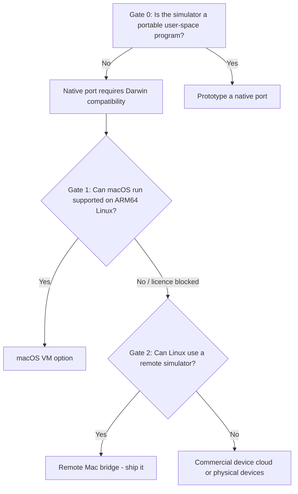

---

title: Analysis plan
sidebar_position: 1
description: The research questions, hypotheses, evidence standards, and decision gates used to choose an architecture.
---

# Analysis plan

**Status:** executed. This page preserves the plan as it was written before the findings were
collected, then records whether each question was answered. Results live in
[Findings](./findings.md), [Architecture options](./architecture-options.md), and
[Feasibility matrix](./feasibility-matrix.md).

**Research window:** 25 October 2026.
**Environment under test:** macOS 27.0.1 (build 26A434), Apple Silicon (`arm64`), Xcode 27.1
(build 27A9275), iOS 18.4 / 18.5 / 26.4 simulator runtimes, iPhone 16 Pro (UDID
`7AD86EEA-A3F1-4103-B010-C8264B2AC6C6`).
**Primary sources:** shipped Xcode binaries and runtime images, Apple's public documentation and
licences, QEMU documentation, project source code, and direct experiments. Secondary sources are
used only for context and are labelled.

## 1. Goal

Make a productive iOS Simulator workflow available to developers whose workstation runs Linux,
without requiring them to own or sit in front of a Mac, and without overstating what is
technically or legally possible.

That goal hides two different questions:

1. **Can the simulator itself execute on Linux?** This is a systems-compatibility question.
2. **Can a Linux developer use a simulator that executes somewhere else?** This is a distributed-
   systems and product question.

The research must answer both, because a "no" to (1) does not imply a "no" to the overall goal.

## 2. Scope

### In scope

- Apple's iOS Simulator as shipped with Xcode 27.x, including the CoreSimulator service, runtime
  bundles, `simctl`, input injection, screen capture and app installation.
- Linux workstations on x86_64 and arm64.
- Single-developer and small-team use, including CI.
- Local-network and SSH-tunnelled connectivity.
- The legal and licensing constraints that affect distribution and hosting.
- A working reference implementation of the chosen option, with tests and documentation.

### Out of scope

- Running iOS on non-Apple hardware (jailbreak, stolen firmware, Corellium-style hypervisors).
- Android emulation, React Native/Expo tooling, or cross-platform build systems.
- App Store distribution, code signing for physical devices, or TestFlight.
- A production multi-tenant SaaS. Multi-tenancy is discussed as future work only.
- Reverse-engineering Apple frameworks for the purpose of redistributing them. REA is used only
  to inspect binaries already installed on the Mac for interoperability research.

## 3. Research questions

| ID  | Question                                                                                            | Why it matters                                                         |
| --- | --------------------------------------------------------------------------------------------------- | ---------------------------------------------------------------------- |
| RQ1 | What is the iOS Simulator architecturally: an emulator, a VM, or host processes?                    | Determines whether a "port" is a packaging problem or a kernel problem |
| RQ2 | Which macOS/Darwin facilities does it require at runtime?                                           | Produces the real porting surface, not a guess                         |
| RQ3 | Which of those facilities already exist on Linux in compatible form?                                | Separates hard blockers from replaceable pieces                        |
| RQ4 | Can macOS itself run in a VM on ARM64 Linux well enough to host Xcode?                              | Tests the "VM escape hatch"                                            |
| RQ5 | What prior art exists, and what can be reused?                                                      | Avoids rebuilding solved pieces                                        |
| RQ6 | What can a Linux client do against a remote simulator today (lifecycle, pixels, input, apps, logs)? | Defines the MVP                                                        |
| RQ7 | What are the latency, bandwidth, and reliability limits of each transport?                          | Determines whether the UX is acceptable                                |
| RQ8 | What legal/licensing constraints apply to hosting, streaming, and redistribution?                   | Prevents a technically working but unusable design                     |

## 4. Hypotheses

Each hypothesis has a falsification condition. The point is to make the research falsifiable,
not to defend a preferred answer.

| ID  | Hypothesis                                                                                        | Falsified if…                                                                        |
| --- | ------------------------------------------------------------------------------------------------- | ------------------------------------------------------------------------------------ |
| H1  | The simulator is a collection of native Darwin user-space processes, not a hardware emulator      | We find a self-contained hypervisor or a Linux-hosted runtime in the shipped product |
| H2  | The simulator depends on Mach IPC, XPC, launchd, `dyld_sim`, Metal/IOSurface and Apple frameworks | Dependency/import analysis shows a portable, self-contained core                     |
| H3  | Darling or a Darling-like layer cannot run a current iOS runtime without major new kernel work    | An existing Darling build boots a current runtime and runs a UIKit app               |
| H4  | QEMU's `vmapple` machine cannot provide a supported macOS guest on non-Apple ARM64 Linux          | QEMU documentation and guest support show a supported path, and licensing permits it |
| H5  | A remote bridge can deliver a usable workflow over LAN/SSH                                        | Capture + input latency or missing APIs make common tasks impossible                 |
| H6  | `simctl` plus `idb` covers lifecycle, capture, install, launch, input and logs                    | A required operation has no supported or maintainable path                           |
| H7  | A token-authenticated HTTP/WebSocket bridge is simple enough to maintain and test                 | The implementation needs a broker, database, or custom codec to be usable            |

## 5. Method

### 5.1 Evidence hierarchy

1. **Shipped artifact evidence** — Mach-O load commands, dependencies, imports, embedded
   metadata, runtime layout. Collected with REA from the installed Xcode/runtime.
2. **Observed runtime evidence** — commands executed against a booted simulator, with timings
   and outputs.
3. **Primary documentation** — Apple developer documentation, QEMU manual, project READMEs and
   source.
4. **Secondary reporting** — blog posts, vendor pages, forum threads. Used for context only.

A claim is only promoted to a finding if it is supported by level 1 or 2, or by level 3 with an
explicit citation. Marketing claims are never treated as feasibility evidence.

### 5.2 Artifact inspection

```bash
# The host-side simulator UI/framework
rea inspect-macho /Applications/Xcode.app/Contents/SharedFrameworks/SimulatorKit.framework/SimulatorKit

# The device lifecycle service
rea inspect-macho /Library/Developer/PrivateFrameworks/CoreSimulator.framework/CoreSimulator

# The init process inside a runtime
rea inspect-macho \
  "/Library/Developer/CoreSimulator/Volumes/iOS_23E254a/Library/Developer/CoreSimulator/Profiles/Runtimes/iOS 26.4.simruntime/Contents/Resources/RuntimeRoot/sbin/launchd_sim"
```

For each image we collect: architecture, build platform, linked frameworks, imported symbols,
and the specific facilities those symbols imply. REA is used because it returns evidence with
provenance and explicit limitations instead of a screenshot of a GUI.

### 5.3 Runtime experiments

| Experiment                | Command                                                | What it establishes                                   |
| ------------------------- | ------------------------------------------------------ | ----------------------------------------------------- |
| List runtimes and devices | `xcrun simctl list -j runtimes`, `devices`             | The runtime is a host-managed device, not a booted VM |
| Inspect the display       | `xcrun simctl io booted enumerate`                     | Pixel dimensions and framebuffer model                |
| Screen capture            | `xcrun simctl io booted screenshot --type=jpeg <file>` | Capture path, latency, payload size                   |
| Input                     | `idb ui tap <x> <y> --udid <udid>`                     | Whether input is available without the Simulator GUI  |
| Video                     | `xcrun simctl io booted recordVideo`                   | Whether a built-in streaming source exists            |
| Process model             | `ps`, `launchctl`, runtime root inspection             | Where `launchd_sim` and apps actually run             |
| Latency                   | repeated timed captures and taps                       | Whether polling capture is usable                     |
| Linux client              | Node client in an OrbStack Linux container             | That the client is genuinely Linux-compatible         |

### 5.4 Linux validation

The client must run in a real Linux userland, not just "should work". The validation unit is a
container built from `node:24-bookworm-slim`, run by OrbStack's Docker engine on the Mac. The
container gets no macOS binaries and no Xcode; it talks to the host daemon over TCP. A second
path uses an OrbStack Linux machine for SSH-tunnel testing.

### 5.5 Evidence quality rules

- Record the exact OS, Xcode, runtime, device, and command.
- Distinguish "not found" from "does not exist"; paged symbol data is not proof of absence.
- Treat private/undocumented SPI as unstable by definition.
- Prefer measured numbers with a stated sample size over adjectives.
- State licence constraints separately from technical constraints; they are both blockers.

## 6. Decision gates

The research feeds a single architecture decision, but only after each gate passes or fails
explicitly.



| Gate | Pass condition                                                                       | Failure action                                                |
| ---- | ------------------------------------------------------------------------------------ | ------------------------------------------------------------- |
| G0   | Simulator core is self-contained and portable                                        | Stop native-port work; do not spend years on a kernel rewrite |
| G1   | Supported macOS guest on non-Apple ARM64, licence-compatible                         | Reject VM option                                              |
| G2   | Lifecycle + capture + input + install + logs work from Linux with acceptable latency | Fall back to commercial cloud                                 |
| G3   | The bridge passes contract, Linux E2E, and macOS integration tests                   | Do not call it a reference implementation                     |
| G4   | Security model is defensible for LAN/SSH use                                         | Restrict to loopback only                                     |

## 7. Deliverables

| Deliverable               | Audience             | Acceptance                                                    |
| ------------------------- | -------------------- | ------------------------------------------------------------- |
| Analysis plan (this page) | Engineering, product | Questions, methods, gates are explicit                        |
| Findings                  | Engineering          | Every major claim has artifact/runtime evidence or a citation |
| Architecture options      | Decision makers      | At least four options, with costs and blockers                |
| Feasibility matrix        | Decision makers      | Weighted criteria and a clear recommendation                  |
| Legal/licensing note      | Legal, product       | Constraints separated from technical ones                     |
| Execution plan            | Engineering          | Phases, tasks, acceptance criteria, risks, rollback           |
| Testing strategy          | Engineering          | Test pyramid mapped to requirements and CI                    |
| Reference implementation  | Users                | Host + CLI + browser viewer, tested on macOS and Linux        |
| Runbooks                  | Operators            | Host setup, client setup, troubleshooting, security           |
| ADRs                      | Future maintainers   | Alternatives and consequences recorded                        |

## 8. Work plan (as executed)

| Step | Work                                                       | Output                   | Status |
| ---- | ---------------------------------------------------------- | ------------------------ | ------ |
| 1    | Inventory the local toolchain and Xcode runtimes           | Environment baseline     | Done   |
| 2    | Inspect SimulatorKit, CoreSimulator, `launchd_sim`         | Mach-O evidence          | Done   |
| 3    | Map dependencies to Darwin facilities                      | Porting surface table    | Done   |
| 4    | Test `simctl` lifecycle, capture, video, logs              | Runtime evidence         | Done   |
| 5    | Test input injection with and without the GUI              | Input decision           | Done   |
| 6    | Evaluate Darling, QEMU `vmapple`, Corellium, device clouds | Option analysis          | Done   |
| 7    | Measure capture and input latency                          | Transport sizing         | Done   |
| 8    | Choose architecture and write ADRs                         | Decision                 | Done   |
| 9    | Implement host, protocol, CLI, viewer                      | Reference implementation | Done   |
| 10   | Test on macOS and in a Linux container                     | Test evidence            | Done   |
| 11   | Write execution plan, test strategy, runbooks              | Documentation            | Done   |

## 9. Risks to the research itself

| Risk                                                  | Mitigation                                                                 |
| ----------------------------------------------------- | -------------------------------------------------------------------------- |
| Overfitting to one Xcode version                      | Record versions; isolate backend behind an interface; note SPI volatility  |
| Mistaking private SPI for a stable API                | Treat `idb` and `simctl` behaviour as replaceable adapters; contract tests |
| Believing vendor marketing                            | Require primary docs or hands-on evidence                                  |
| Treating "works on my Mac" as "works for Linux users" | Run the client in a Linux container in CI                                  |
| Ignoring licensing until the end                      | Legal constraints are a first-class gate (G1/G4)                           |
| Scope creep into a native port                        | Separate research track with explicit kill criteria                        |

## 10. What would change the conclusion

The recommendation to use a remote Mac bridge would be revisited if any of the following became
true:

- Apple shipped a Linux-hosted simulator or a supported remote-simulator protocol.
- A maintained open-source project booted current iOS runtimes on Linux with Metal-backed
  rendering and acceptable performance.
- QEMU (or another hypervisor) gained supported, licence-compatible macOS guests on non-Apple
  ARM64 hardware and Xcode ran reliably inside.
- A commercial API offered the same fidelity at a lower total cost than owning Mac hosts.

None of these is true as of the research date. The [roadmap](../plans/roadmap.md) includes
triggers to re-run this analysis.

## 11. Results summary

All research questions were answered; the detailed evidence is linked below.

| Question | Answer                                                                        | Evidence                                                                |
| -------- | ----------------------------------------------------------------------------- | ----------------------------------------------------------------------- |
| RQ1      | Host-process user-space simulator, not an emulator                            | [Findings §2](./findings.md#2-what-the-simulator-actually-is)           |
| RQ2      | Mach/XPC/launchd/dyld/Metal/IOSurface/Apple frameworks                        | [Findings §3](./findings.md#3-the-dependency-surface)                   |
| RQ3      | Only fragments exist on Linux; no compatible core                             | [Findings §4](./findings.md#4-what-linux-would-have-to-provide)         |
| RQ4      | Not supported/licence-compatible on ARM64 Linux                               | [Options B](./architecture-options.md#option-b-macos-vm-on-arm64-linux) |
| RQ5      | idb, FBSimulatorControl, ScreenCaptureKit patterns are reusable               | [Prior art](./prior-art.md)                                             |
| RQ6      | Lifecycle, capture, install, launch, input (via idb), logs                    | [API reference](../reference/api.md)                                    |
| RQ7      | ~0.36 s per JPEG frame, ~370–430 KB; ~0.22 s per tap (warm)                   | [Findings §6](./findings.md#6-measured-behaviour)                       |
| RQ8      | Hosting/streaming is constrained by Apple licences; no runtime redistribution | [Legal note](./legal-and-licensing.md)                                  |
