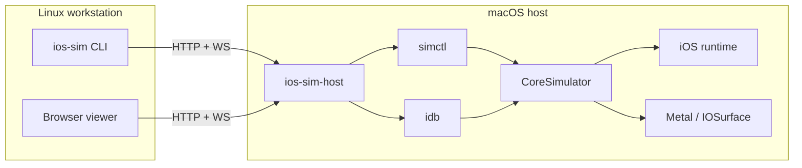

# Architecture options

The research question is not "how do we compile the simulator for Linux?" It is "how do we give
a Linux developer the workflow they need?" Five architectures can do that, with very different
costs and guarantees.

:::note OrbStack is the wrong direction
OrbStack runs Linux machines and containers **on macOS**. It is excellent for validating the
Linux client in this repository, and that is exactly how it is used. It cannot run macOS or the
iOS Simulator **on Linux**. Installing QEMU on a Linux box is similarly useful for ARM64 Linux
VMs, but it does not provide an Apple-compatible macOS guest.
:::

## Option A: native Darwin compatibility layer

:::info Selected for implementation on this branch
Branch `option-a-native-darwin` chooses Option A and implements its foundational user-space
layers. It still does **not** run the iOS Simulator. See the
[native track overview](../native/overview.md),
[limitations](../native/limitations.md), and [ADR 0006](../adr/native-research-track.md) for the
executable evidence and the remaining gates. Option C remains the shipping workflow on `main`.
:::

**Idea:** Reimplement enough of Darwin and Apple's frameworks on Linux to run the simulator's
user-space processes natively.

This is the only option that would produce a true local simulator on Linux. It is also the most
expensive by orders of magnitude.

### What it requires

| Area             | Work                                                                                              |
| ---------------- | ------------------------------------------------------------------------------------------------- |
| Kernel interface | Mach ports/task ports, MIG, bootstrap namespace, Darwin syscalls, kqueue, shared memory semantics |
| IPC              | XPC client/server, Mach-send rights in messages, launchd job registration                         |
| Process model    | `launchd_sim`, `posix_spawn` Darwin attributes, process roles, jetsam/memory pressure             |
| Loader           | Mach-O loader, `dyld_sim`, shared cache, chained fixups, code-signing validation                  |
| Runtimes         | Apple Objective-C runtime ABI, Swift runtime, Foundation/CoreFoundation behaviour                 |
| Graphics         | Metal API, IOSurface, QuartzCore/CoreAnimation, display link, colour management                   |
| UI               | AppKit (host), UIKit simulator build, accessibility translation                                   |
| Input            | IOKit HID, Indigo/DTUHID, CGEvent                                                                 |
| Security         | Codesign, entitlements, TCC privacy database, keychain, device identity                           |
| Storage          | APFS-compatible disk images, snapshots, `simdiskimaged`                                           |

### Existing starting points

| Project                                         | What it gives                                                                                                | What it does not                                                             |
| ----------------------------------------------- | ------------------------------------------------------------------------------------------------------------ | ---------------------------------------------------------------------------- |
| [Darling](https://github.com/darlinghq/darling) | Mach-O loader, Mach IPC server, POSIX/Darwin syscall layer, partial Foundation/AppKit, early Metal-on-Vulkan | Current iOS runtime, CoreSimulator XPC services, SpringBoard, Metal fidelity |
| [QEMU](https://www.qemu.org/) user-mode         | CPU instruction emulation                                                                                    | Darwin kernel/IPC/frameworks                                                 |
| GNUstep / libobjc2                              | Objective-C runtime and AppKit-like toolkit                                                                  | Apple ABI/SPI, UIKit, Metal                                                  |
| Swift on Linux                                  | Swift compiler/runtime and corelibs                                                                          | Apple frameworks and simulator services                                      |

### What this branch implements

The branch does not stop at a diagram. It implements and tests the substrate:

| Layer            | Implemented on this branch                                                         |
| ---------------- | ---------------------------------------------------------------------------------- |
| Loader           | Mach-O 64/fat parsing, chained fixups, export tries, user-space dyld, slides       |
| Execution        | AArch64 integer interpreter with syscall traps and instruction/deadline budgets    |
| Kernel interface | User-space Mach ports, rights, messages, reply ports, bootstrap registry, MIG-lite |
| IPC              | XPC-style typed codec and request/reply over Mach                                  |
| Process model    | Sparse 64-bit VM, launchd-style plist jobs, MachServices, bounded KeepAlive        |
| Syscalls         | Darwin BSD subset with a jailed file layer and mmap                                |
| Evidence         | Generated fixtures plus a real `clang`-built arm64 Mach-O smoke test               |

It does **not** implement threads, the shared cache, Objective-C/Swift/Foundation, Metal,
IOSurface, UIKit/AppKit, code signing, TCC, `launchd_sim`, CoreSimulator, or SpringBoard.
The [roadmap](../native/roadmap.md) sequences those gates.

### Why it is still not the shipping product

The simulator's private frameworks call Apple APIs directly. A compatibility layer must satisfy
those calls well enough for SpringBoard to boot, render, and accept touches. The implemented
substrate proves the first layers are tractable; it does not shorten the multi-year work that
remains, and it is sensitive to every Xcode release. The remote bridge is still the answer for a
team that needs a workflow this quarter.

**Verdict:** Selected for the research implementation on this branch, with explicit kill criteria.
Not a v0.1 product. The shipping decision on `main` remains Option C.

## Option B: macOS VM on ARM64 Linux

**Idea:** Run macOS in a VM on an ARM64 Linux host, install Xcode inside, and use the simulator
there. The Linux desktop then connects to the VM's display or a simulator stream.

### QEMU `vmapple`

QEMU has a `vmapple` machine model that mirrors the device model of Apple's
Virtualization.framework. Its own documentation states the prerequisites:

> - Run on Apple Silicon
> - Run on macOS 12.0 or above
> - Have an already installed copy of a Virtualization.framework macOS 12 virtual machine.
>   Note that newer versions than 12.x are currently NOT supported on the guest side.

That is not a path to a current Xcode 27 / macOS 27 environment on a Linux host. It requires an
Apple Silicon host, a macOS host, and an older guest. It also depends on Apple's
`AVPBooter.vmapple2.bin` and a macOS disk image.

### Licensing

Apple's macOS licence restricts running macOS on non-Apple hardware, and virtualising macOS is
permitted only under specific conditions. Even if a technical path existed, distributing or
operating macOS images on generic ARM64 Linux servers would need legal review. This is a
first-class blocker, not a footnote.

### Other hypervisors

- **Apple Virtualization.framework:** macOS-only host, by definition.
- **KVM on ARM64 Linux:** can run Linux guests; there is no supported macOS guest.
- **Asahi Linux / Apple Silicon Linux:** makes Linux run on Apple hardware; it does not make
  macOS run on non-Apple hardware.
- **Docker-OSX-style projects:** x86 macOS in QEMU, often legally questionable, and not a
  supported route to current iOS simulator runtimes.

**Verdict:** Rejected. The technical prerequisites and the licence both fail.

## Option C: remote Mac bridge (recommended)

**Idea:** Keep the simulator on a Mac. Expose its lifecycle, framebuffer, input, apps, and logs
through a small protocol. Linux developers use a CLI and a browser.

This is the architecture implemented in this repository.

### Why it works

| Need               | Provided by                        | Stability                                     |
| ------------------ | ---------------------------------- | --------------------------------------------- |
| Device lifecycle   | `simctl`                           | Public, documented command-line surface       |
| Screen capture     | `simctl io screenshot`             | Public command; measured ~0.36 s/frame        |
| Input              | `idb ui tap/text/swipe/key/button` | Third-party, private SPI, actively maintained |
| App install/launch | `simctl install/launch/terminate`  | Public command-line surface                   |
| Logs               | `simctl spawn … log stream`        | Public command-line surface                   |
| Transport          | HTTP + WebSocket                   | Standard, testable, no Apple dependency       |
| Viewer             | Browser / CLI                      | Runs on any Linux with Bun or a browser       |

### Variants considered

| Variant                                      | Verdict                                                                                    |
| -------------------------------------------- | ------------------------------------------------------------------------------------------ |
| VNC/Remote Desktop to the Mac desktop        | Works, but exposes the whole desktop, poor multi-user isolation, no CLI, no app upload API |
| SSH + `simctl` wrapper scripts               | Simple, but no pixels, no stream, no structured errors, poor Windows/Linux UX              |
| Xcode remote development                     | Requires Xcode/Apple tooling on the client and a Mac host; not Linux-native                |
| Custom host daemon + protocol (this project) | Best balance: Linux-native clients, testable contract, least privilege                     |

### Costs and limits

- Requires at least one Mac host with Xcode and enough RAM/CPU/GPU for the simulators.
- Network latency matters for interactive use; LAN or SSH tunnel is recommended.
- Video is 2 fps JPEG in v0.1, not 60 fps. Good for development, not for game streaming.
- `idb` is a private-SPI dependency. It is optional (view-only without it), and isolated behind
  an adapter.
- Hosting a Mac for multiple users raises isolation, quota, and licence questions. v0.1 is
  single-user/small-team.

**Verdict:** Adopted. See [ADR 0001](../adr/remote-mac-bridge.md).

## Option D: commercial device cloud

**Idea:** Buy simulator/device access from a vendor.

| Vendor class       | Examples                                              | Strengths                                                  | Limits                                                           |
| ------------------ | ----------------------------------------------------- | ---------------------------------------------------------- | ---------------------------------------------------------------- |
| iOS virtualisation | Corellium                                             | ARM-native virtual devices, root access, security research | Not the Apple Simulator; expensive; different fidelity target    |
| Device clouds      | BrowserStack, Sauce Labs, AWS Device Farm, LambdaTest | Managed iPhones/simulators, CI integrations                | Per-minute cost, limited control, data residency, vendor lock-in |
| Mac hosting        | MacStadium, AWS EC2 Mac, CI macOS runners             | Real Macs, full Xcode                                      | You still build the remote workflow; cost per host               |

Commercial clouds are a sensible **fallback** if the team cannot operate a Mac host. They do not
remove the architectural constraint; they outsource it.

**Verdict:** Viable buy option, not the reference implementation.

## Option E: physical device farm

**Idea:** Run apps on real iPhones connected to a Mac or a Linux host with `usbmuxd`.

- **Pros:** Highest fidelity, real GPU/CPU/network, real sensors.
- **Cons:** Not a simulator, device provisioning and signing, limited concurrency, physical
  maintenance, iOS version sprawl.
- **Linux support:** `libimobiledevice`/`usbmuxd` can talk to devices, but building, signing, and
  debugging still need Apple tooling. It does not solve the simulator problem.

**Verdict:** Complementary for release validation; not a substitute for a simulator.

## Comparison

Scores are 1–5 (5 best). Weights reflect a small product team that needs a usable workflow soon.

| Criterion                     |   Weight | A Native | B macOS VM | C Remote bridge |  D Cloud | E Devices |
| ----------------------------- | -------: | -------: | ---------: | --------------: | -------: | --------: |
| Fidelity to Apple simulator   |      20% |        5 |          5 |               5 |        3 |         2 |
| Time to first usable workflow |      20% |        1 |          1 |               5 |        4 |         2 |
| Linux-only developer UX       |      15% |        5 |          3 |               4 |        4 |         2 |
| Maintenance burden            |      15% |        1 |          2 |               4 |        4 |         2 |
| Cost                          |      10% |        2 |          2 |               4 |        2 |         2 |
| Legal/compliance risk         |      10% |        4 |          1 |               4 |        4 |         5 |
| Input/rendering latency       |       5% |        5 |          3 |               3 |        2 |         5 |
| CI/automation friendliness    |       5% |        3 |          3 |               5 |        4 |         2 |
| **Weighted score**            | **100%** | **2.55** |   **2.35** |        **4.45** | **3.45** |  **2.35** |

The exact scores are judgement calls; the gap is large enough that small changes do not alter the
decision. See the [feasibility matrix](./feasibility-matrix.md) for the evidence behind each
score and the sensitivity analysis.

## Decision

**On this branch:** adopt **Option A** as the implementation target. The native track is
delivered as a layered user-space substrate with tests, documentation, and an ABI. It is
deliberately honest about the fact that it cannot boot the simulator yet.

Boundaries for the native track:

1. No Apple binaries, SDKs, runtimes, shared caches, or firmware are committed or redistributed.
2. Every layer must be testable without a Mac; macOS-only checks are gated and print why.
3. Unsupported instructions, bindings, syscalls, and pointer formats fail with stable codes.
4. The substrate is not a sandbox for untrusted code; file access is jailed and execution is
   bounded, but the host remains in the trust boundary.
5. The shipping product on `main` remains the remote Mac bridge (Option C) until the native
   [gates](../native/limitations.md#kill-criteria) pass.

**On `main`:** the original decision in ADR 0001 is unchanged. This branch is an experiment with
real code, not a claim that the experiment is finished.

## Revisit triggers

Re-run this analysis if:

- Apple ships a supported Linux simulator or remote-simulator API.
- A maintained project boots current iOS runtimes on Linux with Metal-class rendering.
- QEMU or another hypervisor supports current macOS guests on non-Apple ARM64 hardware **and**
  the licence question is resolved.
- `idb` becomes unmaintained and no replacement HID path exists.
- A commercial cloud becomes cheaper than operating Mac hosts for the team's usage.
