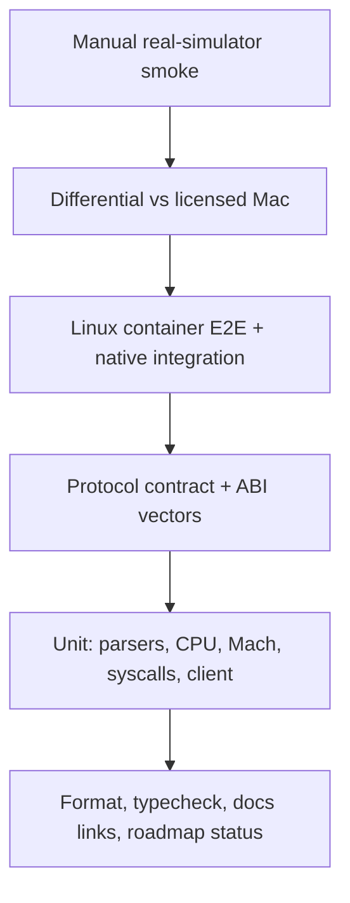

# Engineering quality roadmap

This is the cross-cutting quality roadmap for the remote bridge and the native track. It answers
"how do we know it works, and how do we keep knowing?" The detailed native tasks live in
[QA/OBS/REL](./native/technical.md#qa--verification-fuzzing-differential-performance); the
bridge tests live in the [testing strategy](../plans/testing-strategy.md).

## 1. Current baseline

| Track    | Existing evidence                                                                  | Weak spot                                                                               |
| -------- | ---------------------------------------------------------------------------------- | --------------------------------------------------------------------------------------- |
| Bridge   | Unit/contract tests, Linux container E2E, gated macOS integration, docs link check | CI matrix is not fully wired; no fuzzing of upload/path handling                        |
| Native   | 72 native tests, parser robustness fuzz, generated + real-clang Mach-O, docs build | No coverage-guided fuzzing, differential harness, stress suite, or performance baseline |
| Docs     | Docusaurus build with broken-link check                                            | No automatic check that roadmap status matches code                                     |
| Security | Threat model, token/loopback defaults, jail tests                                  | No formal sandbox for untrusted native code; no security review of the native track     |

The gap is not "more unit tests". It is **evidence at the boundaries**: malformed inputs,
concurrency, reference behaviour, performance regressions, and long-running resource use.

## 2. Maturity model

| Level | Name        | Exit criteria                                                           |
| ----- | ----------- | ----------------------------------------------------------------------- |
| L0    | Ad hoc      | Tests exist but are not run consistently; skips are hidden              |
| L1    | Repeatable  | One command runs unit/contract/docs; failures block merge               |
| L2    | Layered     | Unit + integration + Linux E2E; macOS checks gated with printed reasons |
| L3    | Adversarial | Fuzzing, differential checks, stress/soak, performance budgets          |
| L4    | Maintained  | Compatibility matrix per release, regression corpus, owner and runbook  |
| L5    | Trusted     | Security review, sandbox, reproducible artifacts, audit trail           |

**Current:** bridge ≈ L2–L3; native ≈ L1–L2. Target for the next phase: native L3 for parser,
Mach, and loader layers; bridge L3 for upload and streaming.

## 3. Quality attributes

| Attribute          | What it means here                    | Primary evidence                           |
| ------------------ | ------------------------------------- | ------------------------------------------ |
| Correctness        | The documented contract is what runs  | Unit/integration, contract tests           |
| Determinism        | Same input → same output/exit/status  | Generated fixtures, no sleeps, fixed seeds |
| Robustness         | Malformed input fails safely          | Fuzzing, bounds tests, stable error codes  |
| Concurrency safety | No deadlock/leak under load           | Stress/soak, race tooling                  |
| Reference parity   | Matches macOS where claimed           | Differential harness, recorded versions    |
| Performance        | Budgets measured, regressions blocked | Benchmarks with machine metadata           |
| Observability      | Failures explain themselves           | Traces, counters, missing-surface reports  |
| Security           | Untrusted input cannot escape         | Threat model, sandbox, review              |
| Maintainability    | New Xcode/runtime can be triaged      | Compatibility matrix, runbook              |

## 4. Initiatives

| ID    | Initiative               | Objective                                                   | Exit criteria                                        | Owner  |
| ----- | ------------------------ | ----------------------------------------------------------- | ---------------------------------------------------- | ------ |
| EQ-01 | One-command verification | A clean checkout proves the repo                            | `bun run verify` passes on Linux/macOS; docs built   | REL    |
| EQ-02 | CI matrix                | Every merge sees Linux unit/E2E + docs; macOS on a schedule | Required checks wired; failures actionable           | REL    |
| EQ-03 | Parser fuzzing           | No host crash/OOM from malformed inputs                     | ≥1M mutations per parser; corpus retained            | QA     |
| EQ-04 | Differential harness     | Claims match a licensed Mac                                 | ≥100 cases; differences triaged with versions        | QA/LEG |
| EQ-05 | Stress/soak              | Concurrency and resources are bounded                       | 24h native soak; no leak/deadlock; bridge 30min soak | QA     |
| EQ-06 | Performance budgets      | Regressions are visible                                     | Baselines recorded; >10% regression blocks           | QA/GFX |
| EQ-07 | Observability            | A failure can be diagnosed from artifacts                   | Trace/stats/why + missing-symbol report              | OBS    |
| EQ-08 | Security review          | Trust boundaries are explicit and tested                    | Native sandbox gate; bridge review signed off        | SEC    |
| EQ-09 | Supply chain             | Builds are reproducible and audited                         | Lockfile, no install scripts, artifact hashes        | REL    |
| EQ-10 | Documentation integrity  | Docs match code and each other                              | Link check + roadmap/ABI review in PR checklist      | DX/REL |
| EQ-11 | Compatibility matrix     | Apple updates are triaged, not surprises                    | Matrix per release; owner + runbook                  | REL    |
| EQ-12 | Test debt budget         | Skipped/flaky tests cannot accumulate                       | Skips printed and tracked; flaky test is a bug       | QA     |

## 5. Test pyramid

| Layer        | Bridge                                          | Native                                          |
| ------------ | ----------------------------------------------- | ----------------------------------------------- |
| Static       | `bun run format:check`, `typecheck`, docs build | same                                            |
| Unit         | schemas, parsers, coordinates, errors           | Mach-O, fixups, CPU, Mach, XPC, syscalls, plist |
| Contract     | host HTTP/WS against mock backend               | ABI golden vectors, Mach/MIG vectors            |
| Integration  | Linux container E2E                             | generated Mach-O end-to-end, launchd jobs       |
| Differential | simctl/idb outputs                              | syscalls/Mach/loader/runtime vs licensed Mac    |
| Adversarial  | upload/path/fuzz                                | parser/Mach fuzz, stress/soak                   |
| Performance  | capture/tap/stream latency                      | interpreter/Mach/loader/frame budgets           |
| Security     | token/bind/upload                               | jail/sandbox/signing/TCC                        |

## 6. Fuzzing plan

| Target         | Harness                          | Corpus                         | Stop condition                         |
| -------------- | -------------------------------- | ------------------------------ | -------------------------------------- |
| Mach-O parser  | deterministic + coverage-guided  | generated valid/invalid images | 1M runs, no host crash, bounded memory |
| Chained fixups | structured bitfield mutations    | 64/64-offset/arm64e words      | no out-of-bounds/cycle hang            |
| Export trie    | byte mutations                   | nested/cyclic offsets          | depth/node limits hold                 |
| XPC codec      | random bytes + structured values | nested dict/array/data         | depth/size/keys rejected cleanly       |
| plist          | XML mutations                    | launchd manifests              | no entity/DTD/depth bypass             |
| MIG            | length/descriptor mutations      | calls/replies                  | no host crash; stable errors           |
| Guest programs | instruction mutations            | A64 corpus                     | interpreter traps, no host crash       |
| Bridge upload  | tar path/symlink/size            | malicious bundles              | no traversal/zip bomb                  |

Fuzzing never runs untrusted code on the host without SEC-006. Parser fuzzing is in-process and
bounded; native guest fuzzing waits for the sandbox gate.

## 7. Differential testing plan

Differential tests compare **observable results**, not implementation:

1. Record macOS/Xcode/runtime versions in the test artifact.
2. Run the same fixture or query on a licensed Mac and the compatibility layer.
3. Compare exit status, stdout/stderr, syscall results, Mach return codes, symbol resolution,
   frame hash, and accessibility tree as applicable.
4. Store only normalized outputs/hashes, never Apple binaries.
5. Any difference is `expected`, `known-bug`, or `unexplained`; unexplained blocks the gate.

Initial cases: syscall errors, Mach rights/replies, loader symbols, ObjC message dispatch,
Foundation collections, UIKit frame hashes.

## 8. CI matrix

| Job                 | Runner                | Required          | Contents                               |
| ------------------- | --------------------- | ----------------- | -------------------------------------- |
| Linux unit/docs     | Ubuntu                | PR                | install, format, typecheck, test, docs |
| Linux E2E           | Ubuntu + Docker       | PR                | bridge container E2E + native demo     |
| macOS build         | macOS                 | PR/release        | build, unit, native clang fixture      |
| macOS integration   | macOS dedicated       | release           | `IOS_SIM_MACOS_TESTS=1`                |
| Native fuzz (smoke) | Ubuntu                | nightly           | time-boxed fuzz targets                |
| Performance         | self-hosted/reference | nightly           | budgets, artifact                      |
| Compatibility       | licensed Mac          | per Xcode/runtime | matrix update                          |

The bridge and native tracks share the static/docs jobs but keep separate integration jobs so a
native failure cannot mask a bridge regression.

## 9. Performance budgets

Use the native budgets in
[Technical roadmap §9](./native/technical.md#9-quality-gates-and-budgets). For the bridge, keep
the product metrics: tap p95 under 500 ms on LAN, frame age under 1 s at 2 fps, capture ~0.36 s/frame on the
reference Mac, and no host crash in a 30-minute two-client soak. Record machine, OS, and build
mode with every result.

## 10. Observability

- Structured JSON events with stable names; no unbounded labels.
- Request IDs for bridge; task/thread/port IDs for native.
- Missing-symbol/MIG reports instead of crash-only failures.
- Trace export (Chrome/JSON) with redaction.
- One `why`/`doctor` command that summarizes capabilities and the last failure.

## 11. Security

The [threat model](../security/threat-model.md) covers the bridge. Native adds:

- untrusted Mach-O execution is **not** supported until SEC-006;
- the file jail is path-based, not an OS sandbox;
- code signing/TCC/keychain are not implemented yet;
- fuzzing is not a substitute for a sandbox;
- no Apple binaries or runtime redistribution.

Security tasks are gates, not backlog polish.

## 12. Maintenance and release

1. Pin Bun and tool versions; test upgrades against both tracks.
2. Record Xcode/runtime versions for every differential run.
3. Maintain a compatibility matrix per release.
4. Keep regression fixtures for every fixed parser/concurrency bug.
5. Re-run affected phase gates after Apple updates.
6. Publish evidence and known gaps with every release.

## 13. Sequencing

| Phase         | Quality work                                        |
| ------------- | --------------------------------------------------- |
| Now           | EQ-01, EQ-02, EQ-03, EQ-07 (schema/stats), EQ-10    |
| A1            | EQ-05 (native stress), EQ-06 (baseline), EQ-11      |
| A2            | EQ-03 (loader/plist), EQ-04 (loader/runtime), EQ-09 |
| A3+           | EQ-04 (CoreSimulator), EQ-08 (sandbox), EQ-12       |
| Every release | EQ-10, EQ-11, evidence audit                        |

## 14. Success metrics

| Metric                                          | Target    |
| ----------------------------------------------- | --------- |
| Required CI checks green on merge               | 100%      |
| Hidden skips                                    | 0         |
| Parser fuzz crashes                             | 0         |
| Unexplained differential cases                  | 0 at gate |
| Native leak growth in 24h soak                  | 0         |
| Performance regression >10% merged without note | 0         |
| Docs link failures                              | 0         |
| Roadmap tasks done without evidence             | 0         |

## 15. Non-goals

- 100% coverage as a number.
- Fuzzing Apple code we do not own.
- Running untrusted binaries before the sandbox gate.
- Using a licensed Mac as a hidden runtime dependency for Linux execution.
- Replacing human security/legal review with automation.
