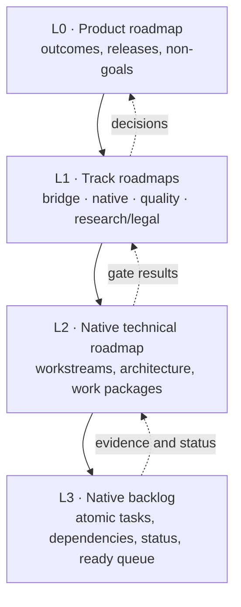

# Roadmap system

This repository has more than one roadmap because it has more than one kind of question. Mixing
"what product are we building?" with "which Mach trap is next?" produces a document nobody can
use for either job. The roadmaps are therefore layered, and every layer links to the one below.

## The four altitudes

| Altitude | Document                                                | Question it answers                                            | Update cadence            |
| -------- | ------------------------------------------------------- | -------------------------------------------------------------- | ------------------------- |
| **L0**   | [Product roadmap](../plans/roadmap.md)                  | What outcomes matter, in what order, and what is out of scope? | Per release or quarterly  |
| **L1**   | [Native platform roadmap](../native/roadmap.md)         | Which platform phases are we in, and what gate ends each?      | Per phase or gate         |
| **L1**   | [Engineering quality roadmap](./engineering-quality.md) | How do we know any of this is correct and maintainable?        | Per quarter               |
| **L1**   | [Research and legal roadmap](./research-legal.md)       | What evidence and permissions are required before we continue? | Per gate                  |
| **L2**   | [Bridge execution plan](../plans/execution-plan.md)     | How is the shipping bridge phased and accepted?                | Per release               |
| **L2**   | [Native technical roadmap](./native/technical.md)       | How is each phase decomposed into workstreams and packages?    | When architecture changes |
| **L3**   | [Bridge backlog](./bridge/backlog.md)                   | What is next for the shipping bridge?                          | Every work session        |
| **L3**   | [Native backlog](./native/backlog.md)                   | What is ready now, what is blocked, and what is done?          | Every work session        |

The shipping remote bridge is specified by the [execution plan](../plans/execution-plan.md) and
the [bridge backlog](./bridge/backlog.md). The native track is specified by the native platform
roadmap, the [technical roadmap](./native/technical.md), and the
[native backlog](./native/backlog.md). Quality and research/legal roadmaps cut across both.

## Two active tracks

| Track                       | State                    | Next                          | Queue                                 |
| --------------------------- | ------------------------ | ----------------------------- | ------------------------------------- |
| Remote bridge (Option C)    | Shipping; v0.1 delivered | `BR-HOST-01` upload hardening | [Bridge backlog](./bridge/backlog.md) |
| Native substrate (Option A) | Research; A0 delivered   | `KRN-001` native boundary     | [Native backlog](./native/backlog.md) |

Use a separate worktree per track. The native track is the current research focus; bridge work
is still the product and can proceed without waiting for a native gate. Do not mix the two in a
single commit.

## Status snapshot

**As of 2026-10-26**, on branch `option-a-native-darwin`:

- The remote bridge (Option C) is implemented and remains the shipping workflow.
- The Option A **A0 substrate** is implemented: Mach-O/dyld, arm64 interpreter, Mach ports,
  XPC-style RPC, jailed syscalls, launchd-style jobs, CLI, generated fixtures, and a real-clang
  smoke test.
- A C11/Bun-FFI **native kernel boundary** now implements tasks, port rights, bounded queues,
  blocking receive, timeouts, interruption, bootstrap services, and thread lifecycle objects
  (`KRN-001..005`, `THR-001`).
- A clean-room UIKit-compatible blank window now opens in a **native X11 window** on Linux
  (`UI-000`, software renderer, no web view). It is not Apple UIKit and does not pass UI-G1.
- A0 is **not** a simulator. Threads/blocking receive, the shared cache, Apple runtimes, Metal,
  Apple UIKit, CoreSimulator, SpringBoard, code signing, TCC, and APFS remain open.
- The next critical-path item is **KRN-001: choose and spike the native kernel boundary**. The
  first ready queue is in the [backlog](./native/backlog.md#2-ready-queue).

## How to start a work session

1. Choose a track and open its backlog: [bridge](./bridge/backlog.md) or
   [native](./native/backlog.md).
2. Pick the first `next` task; if it is blocked, take the first unblocked `ready` task in phase
   order. Respect the work-in-progress limit (one critical-path task plus one independent task).
3. Read the task's workstream section in the [execution plan](../plans/execution-plan.md) or
   [native technical roadmap](./native/technical.md).
4. Implement the smallest vertical slice with a test or fixture first.
5. Run the task's acceptance command plus `bun run verify`.
6. Record evidence, update the backlog status, update docs/ABI if behaviour changed, and commit
   an atomic change.
7. If the task reveals a missing decision, add it to the backlog as a `decision` task and take
   the next unblocked item. Do not start a speculative rewrite.

## Status vocabulary

| Status     | Meaning                                                              |
| ---------- | -------------------------------------------------------------------- |
| `done`     | Code, tests, docs, and evidence exist; acceptance command passed.    |
| `next`     | Highest-priority unblocked task; work may start now.                 |
| `ready`    | Unblocked and specified; pick it when capacity allows.               |
| `blocked`  | Cannot start until a named dependency is done or a decision is made. |
| `proposed` | Useful but not yet scheduled or fully specified.                     |
| `dropped`  | Deliberately removed; the reason is recorded.                        |

Task states are evidence claims. A task is not `done` because code exists; it is done when its
acceptance test and documentation exist and its command has been run.

## Planning rules

1. **One canonical status.** Status lives only in the backlog. Workstream docs describe scope;
   they do not duplicate checkboxes.
2. **Stable IDs.** `KRN-003` never gets reused for a different task. If scope splits, add
   `KRN-003a` rather than repurposing the ID.
3. **Dependencies are explicit.** Every task lists its blockers. A task with an unresolved
   decision is `blocked`, not "sort of ready".
4. **Parallel lanes are deliberate.** The kernel, loader, quality, and research/legal lanes can
   progress in separate worktrees. They must not both edit the same ABI document without a merge
   plan.
5. **Evidence over estimates.** Effort labels are relative sizes, not promises. Gate decisions
   cite commands, artifacts, or a licensed-Mac observation.
6. **Kill criteria stay visible.** A roadmap that cannot stop is not a plan. The native platform
   roadmap and research/legal roadmap carry the stop conditions.
7. **No Apple binaries.** Roadmap evidence must not require committing SDKs, runtimes, apps, or
   device data.

## Where the documents live

| Document                    | Path                                             |
| --------------------------- | ------------------------------------------------ |
| Roadmap hub                 | `docs-site/docs/roadmaps/index.md`               |
| Product roadmap             | `docs-site/docs/plans/roadmap.md`                |
| Bridge execution plan       | `docs-site/docs/plans/execution-plan.md`         |
| Native platform roadmap     | `docs-site/docs/native/roadmap.md`               |
| Native technical roadmap    | `docs-site/docs/roadmaps/native/technical.md`    |
| Native backlog              | `docs-site/docs/roadmaps/native/backlog.md`      |
| Engineering quality roadmap | `docs-site/docs/roadmaps/engineering-quality.md` |
| Research and legal roadmap  | `docs-site/docs/roadmaps/research-legal.md`      |

## What this system does not do

- It does not promise that the remaining native phases will succeed.
- It does not replace ADRs. A task that changes an architectural decision must add or supersede
  an ADR before it lands.
- It does not turn a multi-year platform effort into a sprint. It makes the next increment
  obvious and keeps the evidence honest.
