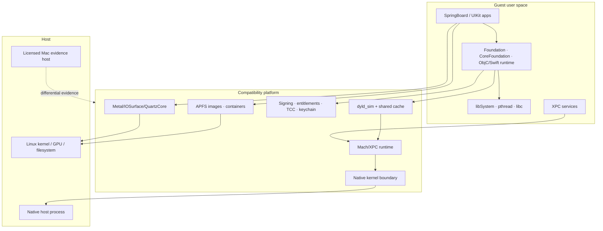

# Native technical roadmap

This is the detailed, execution-grade roadmap for the Option A native Darwin compatibility
layer. It decomposes the high-level [native platform roadmap](../../native/roadmap.md) into
workstreams and work packages. The [native backlog](./backlog.md) owns live status and the order
of work; this page owns scope and acceptance.

**Audience:** engineers and agents who will implement the next task. If you only need the
current status, read the backlog. If you need to decide whether a task is in scope or how it is
proven, read this page.

**Current baseline:** A0 substrate complete on branch `option-a-native-darwin` (commit
`83b9af1`). It executes generated arm64 Mach-O programs and a real clang-built fixture. It is not
a simulator. See [limitations](../../native/limitations.md).

## 1. How to use this roadmap

1. Find the workstream and task ID in the backlog.
2. Read the task row here and the workstream notes.
3. Check dependencies in the backlog; if a dependency is not `done`, the task is not startable.
4. Implement the smallest vertical slice that satisfies the acceptance column.
5. Record the acceptance command and result in the backlog evidence field.
6. Add or update docs/ABI/ADR if the behaviour or contract changed.
7. Commit one coherent change; do not mix unrelated workstreams.

Task IDs are stable. If a task splits, append a letter (`LDR-006a`) rather than reusing the ID.
If a task is dropped, record why in the backlog and leave the ID retired.

## 2. Baseline: what A0 actually proves

| Area           | Evidence                                                               | What it does **not** prove              |
| -------------- | ---------------------------------------------------------------------- | --------------------------------------- |
| Mach-O parsing | `packages/darwin-compat/src/macho/*`, parser tests, real clang fixture | shared cache, legacy bindings           |
| Chained fixups | 64/64-offset/arm64e tests, cross-image bind integration                | PAC enforcement, cache fixups           |
| A64 execution  | interpreter tests, generated programs, real clang program              | SIMD/FP, atomics, JIT performance       |
| Mach semantics | rights/reply/queue/service tests, interpreted bootstrap ping           | blocking, threads, descriptors          |
| XPC/MIG        | codec and request/reply tests                                          | Apple wire compatibility                |
| Syscalls       | jail, file I/O, mmap, trap tests                                       | signals, fork/exec, network, fstat      |
| launchd        | plist/MachServices/RunAtLoad/KeepAlive tests                           | launchd_sim, sockets, on-demand         |
| Quality        | unit/integration/robustness tests, docs build                          | fuzzing at scale, differential Mac runs |

The A0 acceptance commands are recorded in the backlog under `A0-*` tasks. The baseline is a
foundation to extend, not a finished platform.

## 3. Target architecture

The end state still has a legal boundary: no Apple runtime is redistributed. A licensed Mac is
an evidence and conformance host, not a hidden execution dependency for the Linux build.

## 4. Invariants

1. **No silent success.** Unsupported behaviour has an error code or a counted diagnostic.
2. **Every layer testable on Linux.** macOS-only evidence is gated and prints its reason.
3. **No Apple binaries in the repository.** Generated fixtures or local build output only.
4. **Bounded resources.** Memory, queues, parsers, instruction counts, and deadlines have limits.
5. **Native boundary is explicit.** TypeScript may remain the semantic oracle, but blocking,
   threads, and kernel objects cannot be faked forever.
6. **Security is a gate, not a polish item.** Untrusted-code support requires SEC-006.
7. **The shipping bridge is not destabilised.** Native work stays in its packages/apps and must
   not break the bridge's tests.
8. **Every architectural change gets an ADR.** No hidden second protocol or codec.

## 5. Phase and lane plan

| Phase      | Theme                    | Workstreams                                        | Exit gate              |
| ---------- | ------------------------ | -------------------------------------------------- | ---------------------- |
| A0         | Substrate                | Mach-O, CPU, Mach, XPC, syscalls, launchd, CLI     | complete               |
| A1         | Real concurrency         | KRN, THR, OBS-001/002, QA-001/004/005, REL-001/002 | KRN-G1, THR-G1         |
| A2         | Real loader/runtime      | LDR, RT, QA-002/003, DX-001/002                    | LDR-G1, RT-G1          |
| A3         | CoreSimulator boundary   | CS, OBS-003, LEG-002                               | CS-G1                  |
| A4         | Graphics                 | GFX, QA-004, GFX-G1                                | GFX-G1                 |
| A5         | UI                       | UI, DX-005                                         | UI-G1                  |
| A6         | Input, security, storage | INP, SEC, STO                                      | INP-G1, SEC-G1, STO-G1 |
| A7         | SpringBoard/runtime      | SB, REL-007                                        | SB-G1                  |
| Continuous | Evidence/quality/legal   | OBS, QA, REL, LEG, DX                              | every phase            |

### Parallel lanes

| Lane                      | Starts | Can run beside | Why                                                                 |
| ------------------------- | ------ | -------------- | ------------------------------------------------------------------- |
| K · Kernel/threads        | A1     | L, Q, R, E     | Critical path, but much of LDR is independent                       |
| L · Loader/runtime        | A1     | K, Q, R, E     | Legacy bindings/initializers can be tested in the current substrate |
| G · Graphics inventory    | A1     | K, L, Q, R     | API inventory and headless spike can start before a full kernel     |
| S · System integration    | A3     | G, Q, R        | Needs loader/runtime diagnostics                                    |
| Q · Quality/observability | now    | all            | Continuous; owns fuzzing, benchmarks, traces                        |
| R · Research/legal        | now    | all            | Gates funding and runtime access                                    |
| E · Evidence host         | now    | all            | Licensed-Mac observation; no binaries leave the host                |

**Critical path:** `KRN-001 → KRN-002 → KRN-003 → KRN-004/5 → THR-001/2 → LDR-003 → CS-001/4 →
GFX-002/5 → UI-002/3 → SB-002/3 → SB-007`.

## 6. Workstreams and work packages

Sizes are relative: **XS** < 0.5 day, **S** 1–3 days, **M** 1–2 weeks, **L** 2–6 weeks, **XL**

> 6 weeks. They are planning labels, not commitments.

### KRN — Native kernel boundary and Mach

**Mission:** move task/thread/port/memory semantics behind a native boundary that supports
blocking, real concurrency, and resource accounting, while keeping the TypeScript model as a
test oracle.

**Scope:** host ABI, tasks, ports, rights, message queues, blocking send/receive, port sets,
notifications, descriptors, memory objects, quotas.

**Status:** KRN-001..005 are implemented in `packages/darwin-host` (C11 + Bun FFI). KRN-006 and
later remain. See [ADR 0007](../../adr/native-kernel-boundary.md) and the
[host ABI](../../native/host-abi.md).

**Non-goals:** scheduler policy research, distributed IPC, kernel modules, GPU, filesystem.

**Key design question:** C11 + Bun FFI versus a Rust `cdylib` versus a separate host process with
a small protocol. KRN-001 answers it with a spike. The default preference is the smallest
boundary that supports blocking without a second protocol; a separate process adds a protocol
and failure mode that must be justified.

| ID      | Task                                          | Size | Depends | Deliverable                                                                    | Acceptance                                                                                          |
| ------- | --------------------------------------------- | ---- | ------- | ------------------------------------------------------------------------------ | --------------------------------------------------------------------------------------------------- |
| KRN-001 | Choose the native boundary                    | S    | A0      | ADR + spike comparing C11/FFI, Rust/cdylib, separate host                      | A blocking call works from TypeScript on Linux and macOS; build uses Bun tooling; decision recorded |
| KRN-002 | Define host ABI v1                            | M    | KRN-001 | Versioned header/IDL + TS bindings for tasks, threads, ports, rights, messages | Golden vectors round-trip; ABI version checked at startup; mismatch fails clearly                   |
| KRN-003 | Native task/port/right objects                | L    | KRN-002 | Task table, port table, right refcounts, name reuse, task teardown             | Parity tests against TS model for create/send/receive/deallocate; no leaks over 100k cycles         |
| KRN-004 | Message queues and copy                       | L    | KRN-003 | Bounded queues, inline and OOL copy, size/limit errors                         | Fuzz header/body/descriptor lengths; queue overflow returns stable error                            |
| KRN-005 | Blocking send/receive, timeouts, interruption | M    | KRN-004 | Blocking waits with wakeups, timeout, interrupt                                | Two native threads send/receive; timeouts within ±5 ms on dev host; interruption test               |
| KRN-006 | Port sets and notifications                   | M    | KRN-005 | Port-set select, dead-name/no-sender notifications                             | Select over 100 ports; notification delivered exactly once; teardown safe                           |
| KRN-007 | Port/memory descriptors in transit            | M    | KRN-004 | Descriptor parser/validator and right disposition                              | COPY_SEND/MAKE_SEND_ONCE tests; invalid disposition rejected                                        |
| KRN-008 | MIG wire compatibility                        | L    | KRN-007 | Descriptor-compatible MIG subset + differential vectors                        | Vectors from a licensed Mac match for supported routines; unknown routines report cleanly           |
| KRN-009 | Memory objects and shared memory              | L    | KRN-003 | VM object, map/unmap, COW/shared mapping                                       | Two tasks share read/write pages; COW isolation test; unmap invalidates                             |
| KRN-010 | Mach trap parity table                        | M    | KRN-005 | Implemented/unsupported trap table with diagnostics                            | Every exercised trap has success/error vector; fuzz does not crash host                             |
| KRN-011 | Quotas and resource accounting                | S    | KRN-005 | Per-task port/message/memory quotas                                            | Quota teardown; no cross-task interference                                                          |
| KRN-012 | Native stress and soak                        | M    | KRN-005 | Multi-thread ping-pong, leak, and shutdown harness                             | 1M messages, 16 threads, no leak; CI target < 60 s                                                  |

**Exit gate KRN-G1:** blocking Mach semantics survive a multi-thread stress run; the TS oracle
and native host agree on rights/messages; no unbounded queue or leak; Linux and macOS builds pass.

**Risks:** FFI copy overhead; scheduler complexity leaking into the ABI; Windows/macOS host
differences. Mitigation: keep the ABI in terms of Mach objects, not host threads; benchmark before
committing to a boundary.

### THR — Threads, scheduling, process model

**Mission:** make guest processes behave like processes: multiple threads, blocking calls,
signals, spawn/exec, timers, and teardown.

**Depends on:** KRN-G1. THR-001/002 can start once KRN-003 exists.

**Status:** THR-001 is implemented in `packages/darwin-host` (thread lifecycle objects and thread
ports, C + FFI tests). THR-002 is implemented as a cooperative guest CPU scheduler in
`packages/darwin-compat/src/runtime/scheduler.ts` (round-robin, block/unblock, budgets). THR-003
is implemented as `runtime/blocking.ts` (park/wake/timeout/interrupt tests), and THR-003a wires
it into `DarwinSyscallKernel` with a real `mach_msg_trap` park/resume test. THR-004 provides a
pthread core shim (create/join/mutex/cond) with an 8-worker fixture; once/TLS/libc bindings remain
RT-010. THR-005 adds guest signal handlers, masks, raise/kill, default actions, and context
save/restore. THR-006 adds a ProcessTable with memory/CPU fork cloning, exec replacement,
waitpid/reaping, and process groups; THR-006a wires it into guest syscalls through `ProcessRuntime`.
THR-007 adds argv/env stack construction and stdout/stderr spawn redirection; arbitrary `dup2`
actions remain future work. THR-008 adds a guest timer/source event loop with deadline ticks; THR-009 adds realtime/monotonic
clocks, timebase conversion, and event-loop sleep. Loader work (LDR-001) is next.

| ID      | Task                               | Size | Depends          | Deliverable                                      | Acceptance                                                                     |
| ------- | ---------------------------------- | ---- | ---------------- | ------------------------------------------------ | ------------------------------------------------------------------------------ |
| THR-001 | Thread objects and thread ports    | M    | KRN-003          | Guest thread table, thread ports, thread groups  | Create/join/terminate; port identity stable; teardown frees names              |
| THR-002 | Scheduler and run queue            | L    | THR-001          | Deterministic scheduler with priorities/yield    | N threads make progress; no starvation in test matrix; traces explain switches |
| THR-003 | Blocking syscall bridge            | M    | KRN-005, THR-002 | Syscall block/wake integration                   | read/recv blocks one thread, wakes another; timeout/interrupt paths            |
| THR-004 | pthread/libSystem shim             | L    | THR-003a         | `pthread_create/join/mutex/cond/once/TLS` subset | Fixture program runs 8 workers; differential against a Mac where possible      |
| THR-005 | Signals and delivery               | L    | THR-001          | Signal state, handlers, masks, `raise/kill`      | Default/ignored/handled paths; blocked signal queued; `waitpid` interaction    |
| THR-006 | fork/exec/waitpid/process groups   | L    | THR-001          | Process creation and reaping                     | Parent/child exit status, pipes? no pipes yet; group signalling                |
| THR-007 | posix_spawn attributes             | M    | THR-006          | File actions, attributes, environment            | Spawn a fixture with redirected fds and custom argv/env                        |
| THR-008 | kqueue/timers/event loop           | L    | THR-003          | timer and event sources                          | Timer precision; event loop wakeup; no busy wait                               |
| THR-009 | Clock and timebase                 | S    | THR-003          | Monotonic/realtime clocks                        | Timebase conversion; sleep/wake accuracy                                       |
| THR-010 | Jetsam and memory pressure         | M    | KRN-009          | Pressure signals and task kill policy            | Pressure event reaches guest; kill policy test                                 |
| THR-011 | Roles, sessions, process contracts | M    | THR-006          | launchd-style session/role model                 | Job gets expected identity/ports; teardown order                               |
| THR-012 | Concurrency stress                 | M    | THR-004          | Thread/process soak harness                      | 64 threads/processes, no deadlock/leak; CI target                              |

**Exit gate THR-G1:** a multi-threaded fixture blocks, wakes, times out, signals, spawns, and
exits cleanly; the host can tear everything down without leaks.

### LDR — Loader, shared cache, signing

**Mission:** behave like dyld for real images, not only current chained-fixup fixtures.

**Can start before KRN-G1** for opcode/parser work; initializers and `dlopen` need thread-safe
state.

**Status:** LDR-001/002 are implemented in `packages/darwin-compat/src/macho/legacy-fixups.ts` and
wired into `ImageLoader`. Rebase streams slide in-image pointers; bind streams resolve by ordinal;
lazy sites are recorded and bound on first `bindLazy(address)`; weak binds resolve flat and
missing symbols become null. LDR-003 runs `__mod_init_func`/`__mod_term_func` around `main` with
deduplication and stage-attributed failures. LDR-004 adds reference-counted dynamic image handles
(`open`/`symbol`/`close`) with unload/eviction; guest `dlopen` traps are not wired. LDR-005 adds
dependency-ordinal two-level binds, flat load-order collision handling, and `__interpose`
replacement pairs. LDR-010 parses embedded signatures (superblob, CodeDirectory, XML
entitlements) without verifying hashes or certificates. LDR-013 adds structured loader
diagnostics and a CLI failure report. LDR-012 adds read-only bundle/fileset/dSYM metadata
(`Info.plist`, `LC_FILESET_ENTRY`, `N_OSO`). The loader lane is now gated on licensed-Mac work for
the shared cache and on later security work for verification. THR-012 stresses 64 guest threads
and 64 fork/exit/reap processes; the quality harnesses are next. Executable lazy-stub trampolines, general weak-definition coalescing,
broader namespace policy, DWARF line tables, and signature verification are explicitly still
absent.

| ID      | Task                                     | Size | Depends          | Deliverable                                        | Acceptance                                                                    |
| ------- | ---------------------------------------- | ---- | ---------------- | -------------------------------------------------- | ----------------------------------------------------------------------------- |
| LDR-001 | Legacy dyld rebase/bind opcodes          | M    | A0               | `LC_DYLD_INFO`/`_ONLY` decoder                     | Generated opcode fixtures match symbol targets; malformed streams fail        |
| LDR-002 | Lazy and weak binding                    | M    | LDR-001          | Lazy stub patching, weak lookup/coalescing         | Lazy symbol resolves on first call; weak missing → null; no double-patch      |
| LDR-003 | Initializers/terminators                 | M    | LDR-002          | `LC_ROUTINES`, mod-init/term, init offsets         | Fixture initializers run once in order; term on exit; failure is reported     |
| LDR-004 | dlopen/dlsym/dlclose                     | M    | LDR-003          | Runtime image loading/unloading                    | Load two images, resolve symbols, close; refcounts correct                    |
| LDR-005 | Namespaces and interposition             | L    | LDR-004          | Two-level lookup, weak coalescing, interpose hooks | Namespace collision test; replacement order recorded                          |
| LDR-006 | Shared-cache format parser               | L    | A0               | Header, images, mappings, symbols, UUIDs           | Parse a licensed local cache; no Apple bytes committed; malformed cache fails |
| LDR-007 | Split/subcache mapping and slide         | L    | LDR-006          | Map cache/subcaches at correct addresses           | Fixture/runtime image resolves from cache; slide math tested                  |
| LDR-008 | Cache fixups and symbol resolution       | L    | LDR-007          | Cache chained fixups and symbol table              | Resolve imported function/data; differential symbol list                      |
| LDR-009 | dyld environment and closure             | M    | LDR-004          | `DYLD_*` subset, closure calculation               | Closure list matches expected; unsafe env values rejected                     |
| LDR-010 | Code-signature parser                    | M    | A0               | SuperBlob/CodeDirectory/requirements parser        | Parse ad-hoc and signed fixtures; no verification yet                         |
| LDR-011 | Entitlements extraction and policy hooks | M    | LDR-010          | Entitlement dictionary + policy interface          | Entitlements visible to SEC; invalid blob fails                               |
| LDR-012 | Fileset/bundle/dSYM metadata             | S    | A0               | Metadata parsing for bundles/filesets              | Fixture parse; unknown types reported                                         |
| LDR-013 | Loader diagnostics                       | S    | A0               | Missing image/symbol report with paths/ordinals    | Failure report names image, symbol, ordinal; CLI exposes it                   |
| LDR-014 | Differential loader suite                | M    | LDR-005, LDR-008 | Corpus + expected results from licensed Mac        | ≥50 images/symbol cases match; report generated                               |

**Exit gate LDR-G1:** load a nontrivial dylib closure from a licensed runtime in a test harness;
symbol resolution, initializers, and lazy binding match the reference; no Apple binaries in git.

### RT — Objective-C, Swift, Foundation, libSystem

**Mission:** run a real Objective-C/Swift program without Apple frameworks on the host.

**Depends on:** KRN/THR for threading and memory; can begin ABI research and pure runtime
structures earlier.

| ID     | Task                                 | Size | Depends | Deliverable                                                | Acceptance                                                       |
| ------ | ------------------------------------ | ---- | ------- | ---------------------------------------------------------- | ---------------------------------------------------------------- |
| RT-001 | ObjC runtime core                    | L    | LDR-004 | Classes, metaclasses, selectors, method lists, protocols   | Register class, allocate instance, call method; ABI layout tests |
| RT-002 | Message send and caches              | L    | RT-001  | `objc_msgSend` path, super, method cache                   | Dispatch matrix; cache invalidation; `_cmd/self` correct         |
| RT-003 | Ivars, properties, ARC               | L    | RT-002  | Layout, accessors, retain/release/autorelease              | ARC fixture; weak/strong semantics; no leaks                     |
| RT-004 | Categories, protocols, exceptions    | M    | RT-002  | Category loading, conformance, `@try/@catch`               | Category method overrides; exception unwind                      |
| RT-005 | Blocks and associated objects        | M    | RT-003  | Block ABI, copy/dispose, associations                      | Capture-by-value/reference; association lifetime                 |
| RT-006 | Foundation: strings/collections      | L    | RT-003  | `NSString`, `NSArray`, `NSDictionary`, `NSSet`, `NSNumber` | Conformance tests vs Mac for 100 cases                           |
| RT-007 | Foundation: files/URLs/JSON/plists   | L    | RT-006  | `NSFileManager`, `NSURL`, JSON, plist                      | Read/write inside jail; round-trip tests                         |
| RT-008 | CoreFoundation bridging and run loop | L    | RT-006  | Toll-free bridge subset, run loop/timers                   | Bridge identity; run loop wakes on source                        |
| RT-009 | Swift runtime and metadata           | L    | RT-002  | Metadata discovery, demangling, basic runtime calls        | Swift fixture class/enum/protocol loads and runs                 |
| RT-010 | libSystem/libc/malloc/pthread        | L    | THR-004 | Allocator, stdio subset, pthread/thread APIs               | C fixture with malloc/stdio/threads passes                       |
| RT-011 | Runtime conformance suite            | M    | RT-007  | Cross-check harness for ObjC/Foundation                    | ≥200 assertions match Mac; failures triaged                      |
| RT-012 | Runtime performance                  | M    | RT-011  | Message-send/alloc benchmarks                              | Budgets in §9 met; no pathological cache misses                  |

**Exit gate RT-G1:** a nontrivial ObjC+Swift CLI fixture runs with the documented Foundation
subset; conformance failures are known and listed.

### CS — CoreSimulator boundary and launchd_sim

**Mission:** determine and implement the minimum CoreSimulator/launchd_sim surface needed to
boot, or produce a defensible no-go with a complete missing-surface report.

**Depends on:** KRN-008, LDR-G1, RT-G1 for execution; inventory can start earlier on a licensed
Mac.

| ID     | Task                                       | Size | Depends    | Deliverable                                       | Acceptance                                                  |
| ------ | ------------------------------------------ | ---- | ---------- | ------------------------------------------------- | ----------------------------------------------------------- |
| CS-001 | Inventory CoreSimulator XPC services       | M    | Mac access | Service/routine inventory + dependency graph      | Every discovered service has evidence and status            |
| CS-002 | Inventory launchd_sim job graph            | M    | CS-001     | Jobs, plists, env, ports                          | Graph rendered; required jobs identified                    |
| CS-003 | Bootstrap, peer auth, service registration | M    | KRN-008    | Compatible bootstrap/peer path                    | launcher reaches service lookup; auth placeholders explicit |
| CS-004 | CoreSimulator client protocol subset       | L    | CS-003     | Typed client for device set/state/runtime calls   | Fixture call sequence completes; errors mapped              |
| CS-005 | Device/runtime registry and state machine  | M    | CS-004     | Create/list/boot/shutdown state model             | State transitions tested; invalid transitions rejected      |
| CS-006 | Environment and path contracts             | S    | CS-002     | `SIMULATOR_*`, runtime roots, temp/data paths     | Contract fixture matches reference; paths jailed            |
| CS-007 | Missing-surface diagnostic mode            | M    | CS-004     | Report every missing MIG routine/symbol/framework | boot attempt yields actionable report, not a crash          |
| CS-008 | CoreSimulator go/no-go                     | S    | CS-007     | Written decision with evidence                    | Gate review; default no unless acceptance met               |
| CS-009 | Service implementation order (if go)       | M    | CS-008     | Ordered plan and interface stubs                  | First service boots in isolation; next steps ranked         |
| CS-010 | Licensed proxy fallback design (if no-go)  | M    | CS-008     | Design for a licensed remote CoreSimulator path   | Security/legal review; no hidden redistribution             |

**Exit gate CS-G1:** `launchd_sim` reaches a stable bootstrap point, reports its version, and
enumerates a device, **or** the programme records a no-go with a complete missing-surface report.

### GFX — Metal, IOSurface, QuartzCore

**Mission:** render UIKit frames with acceptable fidelity and latency, starting headless.

**Depends on:** GFX-001 inventory can start now; execution needs KRN/THR and CS decisions.

| ID      | Task                                  | Size | Depends          | Deliverable                                    | Acceptance                                                    |
| ------- | ------------------------------------- | ---- | ---------------- | ---------------------------------------------- | ------------------------------------------------------------- |
| GFX-001 | Metal API usage inventory             | M    | Mac access       | Call/format/feature matrix from a real runtime | Top-100 calls ranked; unsupported list                        |
| GFX-002 | Command queue/encoder subset          | L    | GFX-001          | Queue, command buffer, render/compute encoders | Encode and submit a triangle; validation errors               |
| GFX-003 | Resources, pipelines, heaps           | L    | GFX-002          | Buffers, textures, samplers, pipeline states   | Resource lifetime tests; invalid state rejected               |
| GFX-004 | Shader pipeline                       | XL   | GFX-003          | MSL → SPIR-V or interpreter path               | Shader corpus renders expected output                         |
| GFX-005 | Vulkan backend                        | XL   | GFX-004          | Linux GPU backend                              | Triangle/frame on supported GPU; software fallback documented |
| GFX-006 | IOSurface                             | L    | GFX-003          | Allocate/share/lock/format surfaces            | Cross-process surface test; stride/format                     |
| GFX-007 | Texture formats and colour management | L    | GFX-005, GFX-006 | Format conversion, sRGB/linear, sampler        | Golden colour tests; no banding regressions                   |
| GFX-008 | QuartzCore/CoreAnimation transactions | L    | GFX-002          | Layer tree, transactions, display link         | Animated layer produces expected frames                       |
| GFX-009 | Headless present and capture          | M    | GFX-005          | Offscreen framebuffer + PNG/raw capture        | 10k frames stable; memory flat                                |
| GFX-010 | Window present and vsync              | M    | GFX-009          | Host window/present path                       | Interactive window; frame pacing measured                     |
| GFX-011 | Golden-image harness                  | M    | GFX-009          | Deterministic frame corpus                     | Perceptual diff thresholds; CI artifacts                      |
| GFX-012 | Graphics performance budgets          | M    | GFX-010          | Frame-time benchmark                           | Budgets in §9 met on reference hardware                       |

**Exit gate GFX-G1:** a trivial UIKit view renders 10,000 stable offscreen frames with correct
colour, then presents interactively, or the graphics gate is declared failed.

### UI — UIKit, AppKit, accessibility

**Mission:** boot a minimal UIKit app and expose it through a host window and accessibility tree.

**Depends on:** RT-G1, GFX-G1.

| ID     | Task                                 | Size | Depends           | Deliverable                                        | Acceptance                                         |
| ------ | ------------------------------------ | ---- | ----------------- | -------------------------------------------------- | -------------------------------------------------- |
| UI-000 | Clean-room native blank-window spike | S    | A0 (out of order) | UIKitLite model, software renderer, X11 host       | Xvfb/CLI test: native window, size, colour, resize |
| UI-001 | UIKit private surface inventory      | M    | CS-001            | API/class/dependency matrix                        | Minimal app dependency closure identified          |
| UI-002 | UIApplication/run loop/window/scene  | L    | UI-001, RT-008    | App lifecycle and window hosting                   | Fixture app launches, creates window, exits        |
| UI-003 | UIView/layer/geometry/drawing        | L    | UI-002, GFX-009   | View tree, layout, drawing                         | Frame golden test; hit testing                     |
| UI-004 | Controls, text, layout subset        | L    | UI-003            | UILabel, UIButton, UITextField, Auto Layout subset | Fixture screen matches golden; text wraps          |
| UI-005 | AppKit host window and events        | L    | UI-002            | Host window/menu/event loop                        | Window shows guest frame; input events route       |
| UI-006 | Pasteboard, menus, services          | M    | UI-005            | Clipboard/menu plumbing                            | Copy/paste fixture; menu action                    |
| UI-007 | Accessibility tree                   | M    | UI-003            | AX tree export                                     | Tree matches expected roles/labels; query test     |
| UI-008 | Fonts, text, locale, input methods   | L    | UI-004            | Font fallback, shaping, locale                     | Multilingual golden text; no missing glyph crash   |
| UI-009 | Minimal app conformance              | M    | UI-004, UI-007    | Fixture app + golden/accessibility suite           | Boot→render→tap→text→AX passes                     |

`UI-000` is an out-of-order spike: it proves the native window/renderer boundary without Apple
UIKit, Metal, or a guest app. It does **not** satisfy this gate.

**Exit gate UI-G1:** a fixture UIKit app boots, renders, accepts taps/text, and exposes a
meaningful accessibility tree.

### INP — Input path

**Mission:** deliver HID and CGEvent-compatible input without faking the layer in the CLI.

**Depends on:** THR-002, KRN-005, CS-001.

| ID      | Task                              | Size | Depends          | Deliverable                 | Acceptance                                      |
| ------- | --------------------------------- | ---- | ---------------- | --------------------------- | ----------------------------------------------- |
| INP-001 | HID/Indigo/CGEvent inventory      | M    | Mac access       | Event/format matrix         | Required event types ranked                     |
| INP-002 | HID event translation             | L    | INP-001, KRN-005 | HID → guest event path      | Touch/key events reach fixture; order preserved |
| INP-003 | Touch, button, keyboard injection | M    | INP-002          | Injection API/CLI           | End-to-end tap/text/button test                 |
| INP-004 | CGEvent routing                   | M    | INP-002          | CGEvent-compatible path     | Event coordinates/scale match reference         |
| INP-005 | Input latency harness             | S    | INP-003          | Glass-to-guest measurement  | p95 budget in §9; report artifact               |
| INP-006 | Input fuzzing and limits          | S    | INP-003          | Malformed/rapid event tests | No crash; bounded queues                        |

**Exit gate INP-G1:** the fixture app receives touch/text/button events through the HID path with
measured latency, without relying on a CLI shortcut.

### SEC — Signing, entitlements, TCC, keychain, sandbox

**Mission:** establish an explicit trust model. The current substrate trusts every binary; that
is not acceptable for untrusted input or a multi-user host.

**Depends on:** LDR-010/011, KRN-010.

| ID      | Task                                  | Size | Depends          | Deliverable                      | Acceptance                                          |
| ------- | ------------------------------------- | ---- | ---------------- | -------------------------------- | --------------------------------------------------- |
| SEC-001 | Signing validation policy             | M    | LDR-010          | Verification modes and policy    | Unsigned/tampered/ad-hoc/signed fixtures classified |
| SEC-002 | Entitlement enforcement               | M    | SEC-001, LDR-011 | Entitlement evaluation hooks     | Entitled/denied capability tests                    |
| SEC-003 | TCC privacy database                  | L    | SEC-002          | TCC schema/service               | Grant/deny/revoke persistence test                  |
| SEC-004 | Keychain                              | L    | SEC-002          | Keychain item service            | Add/read/update/delete; access control              |
| SEC-005 | Device identity                       | M    | SEC-002          | Stable simulated identity        | Identity persists; rotation policy                  |
| SEC-006 | OS sandbox and syscall allowlist      | L    | KRN-010          | Host sandbox for guest processes | Escape tests fail; allowed syscalls pass            |
| SEC-007 | Secret handling and host hardening    | S    | SEC-006          | Threat-model update              | No secrets in logs; token/paths reviewed            |
| SEC-008 | Security review and adversarial tests | M    | SEC-003          | Review report + fuzz corpus      | Findings triaged; blockers fixed                    |

**Exit gate SEC-G1:** a signed/entitled fixture sees only permitted capabilities; TCC/keychain
persist; adversarial tests cannot escape the jail.

### STO — Storage and device images

**Mission:** provide APFS-compatible images and per-app data containers.

**Depends on:** SEC-004 for protection, KRN-009 for memory-mapped I/O.

| ID      | Task                     | Size | Depends          | Deliverable                   | Acceptance                                 |
| ------- | ------------------------ | ---- | ---------------- | ----------------------------- | ------------------------------------------ |
| STO-001 | APFS read-only parser    | L    | A0               | Volume/inode/extent reader    | Mount a fixture image read-only; checksums |
| STO-002 | APFS write and snapshots | XL   | STO-001          | Allocation, snapshots, clones | Write/read/snapshot round-trip; crash test |
| STO-003 | simdiskimaged semantics  | L    | STO-002          | Image lifecycle service       | Create/attach/detach device image          |
| STO-004 | Per-app containers       | M    | STO-002          | Data container layout         | Two apps isolated; migration test          |
| STO-005 | Data protection classes  | M    | SEC-004, STO-004 | Key wrapping/class policy     | Locked-device access tests                 |
| STO-006 | Crash consistency        | M    | STO-002          | Journal/recovery path         | Kill during write recovers                 |

**Exit gate STO-G1:** a fixture app persists data across a simulated reboot in an APFS image,
with containers and protection classes enforced.

### SB — SpringBoard and real runtime

**Mission:** boot SpringBoard, install and launch a signed app, and reproduce the observable
simulator workflow.

**Depends on:** UI-G1, INP-G1, SEC-G1, STO-G1, CS-G1.

| ID     | Task                             | Size | Depends        | Deliverable                      | Acceptance                                 |
| ------ | -------------------------------- | ---- | -------------- | -------------------------------- | ------------------------------------------ |
| SB-001 | SpringBoard dependency inventory | M    | CS-007         | Missing-symbol/framework report  | Closure ranked; blockers identified        |
| SB-002 | Boot chain and launchd jobs      | L    | SB-001, CS-009 | SpringBoard boot sequence        | SpringBoard reaches home screen            |
| SB-003 | App install/launch/terminate     | L    | SB-002, UI-002 | Bundle install + launch path     | Fixture app icon/launch/terminate          |
| SB-004 | Lifecycle, rotation, background  | L    | SB-003         | State transitions                | Rotate/background/foreground tests         |
| SB-005 | Home screen/status basics        | M    | SB-003         | Minimal shell UI                 | App grid/status bar golden                 |
| SB-006 | Logs and diagnostics             | M    | SB-002         | Syslog/os_log capture            | App logs visible; filtering                |
| SB-007 | Conformance matrix               | L    | SB-004         | Scenario matrix vs Mac simulator | Required scenarios match within tolerances |
| SB-008 | Runtime/Xcode update process     | M    | SB-007         | Support matrix + update runbook  | New runtime triaged; regressions gated     |

**Exit gate SB-G1:** a current iOS runtime boots on Linux and runs a signed fixture app with the
covered behaviours matching the Mac simulator, or the programme stops with evidence.

### OBS — Observability and debugging

**Mission:** make failures explain themselves. A compatibility layer without diagnostics becomes
an unmaintainable pile of "it crashed".

| ID      | Task                        | Size | Depends | Deliverable                                           | Acceptance                                      |
| ------- | --------------------------- | ---- | ------- | ----------------------------------------------------- | ----------------------------------------------- |
| OBS-001 | Structured event schema     | S    | A0      | Versioned event types for syscalls/Mach/loader/faults | Schema tests; JSON output                       |
| OBS-002 | Runtime statistics          | S    | A0      | Counters for syscalls, messages, faults, memory       | `doctor`/stats output; no unbounded cardinality |
| OBS-003 | Missing symbol/MIG report   | M    | OBS-001 | Collector + human/JSON report                         | Boot failure produces actionable list           |
| OBS-004 | Trace export                | M    | OBS-001 | Chrome/JSON trace of runtime events                   | Trace opens; timestamps ordered                 |
| OBS-005 | CLI trace/stats/why         | M    | OBS-004 | `ios-sim-native trace/stats/why`                      | Commands tested; redaction                      |
| OBS-006 | Fault diagnostics           | M    | OBS-001 | Register/memory/stack dump on fault                   | Undefined instruction shows PC, encoding, maps  |
| OBS-007 | Metrics endpoint (optional) | S    | OBS-002 | Local metrics surface                                 | Loopback-only; documented                       |

**Exit gate OBS-G1:** a failed boot/run can be explained from artifacts without attaching a
debugger.

### QA — Verification, fuzzing, differential, performance

**Mission:** turn "it works on my fixture" into evidence across inputs, concurrency, and
reference behaviour.

**Status:** QA-001 provides `src/testing/fuzz.ts` and `scripts/fuzz-darwin.ts`, a deterministic
outcome-guided mutator with a corpus. `bun run fuzz:1m` runs 1,000,000 mutations per target:
Mach-O 0 crashes / 371 outcomes, plist 0 crashes / 19 outcomes, XPC 0 crashes / 11 outcomes. The
run exposed and fixed a non-`CompatError` UTF-8 failure in the XPC codec. QA-003 generates 23
Mach-O corpus cases (16 valid, 7 invalid) covering 15 load commands, all five chained pointer
formats, legacy streams, signatures, filesets, fat headers, and expected error codes;
`bun run corpus` materializes them under `build/corpus`. QA-004 adds `bun run bench`: machine
metadata plus per-case budgets for Mach-O parse, chained parse, loader load, signature parse, XPC
round-trip, VM map/read, and 64-thread scheduling. On an Apple M3/8-core, Bun 1.4.4, every case
finished in 3-66 ms against a 3-5 s budget. OBS-001 adds schema-v1 runtime events with JSON-safe
values, redaction, NDJSON round-trip, and process start/exit emission. OBS-002 adds monotonic
runtime counters and `ios-sim-native stats` text/JSON output. REL-001 adds a dedicated Linux native-substrate CI job
that runs native tests, the gated clang test (printing its skip reason), the generated corpus, a
100k-per-target fuzz pass, and a scaled benchmark. QA-005 (broader concurrency suite) is next.

| ID     | Task                          | Size | Depends            | Deliverable                                  | Acceptance                                       |
| ------ | ----------------------------- | ---- | ------------------ | -------------------------------------------- | ------------------------------------------------ |
| QA-001 | Fuzz harness for all parsers  | M    | A0                 | Deterministic + coverage-guided harness      | 1M mutations without host crash; corpus retained |
| QA-002 | Differential harness vs macOS | L    | QA-001, Mac access | Compare syscalls/Mach/loader/runtime results | ≥100 cases match; differences triaged            |
| QA-003 | Generated Mach-O corpus       | M    | A0                 | Corpus builder for valid/invalid images      | Corpus covers each load command/fixup format     |
| QA-004 | Performance benchmarks        | M    | A0                 | Baseline suite with machine metadata         | Budgets in §9 recorded; regression check         |
| QA-005 | Concurrency/stress suite      | M    | THR-012            | Thread/process/Mach stress                   | No deadlock/leak; CI target                      |
| QA-006 | Leak and resource checks      | M    | QA-004             | Memory/fd/port leak harness                  | 24h soak flat; no unbounded growth               |
| QA-007 | Coverage targets              | S    | REL-001            | Per-layer coverage report                    | Critical parsers ≥90%; gaps documented           |
| QA-008 | Compatibility matrix          | M    | QA-002             | OS/arch/Xcode/runtime matrix                 | Each cell pass/skip/fail with reason             |

**Exit gate QA-G1:** the project can answer "did this change break a parser, a race, or a
reference behaviour?" with a command.

### REL — Build, CI, release, maintenance

**Mission:** make the native track reproducible and maintainable across Xcode/runtime updates.

| ID      | Task                         | Size | Depends | Deliverable                       | Acceptance                             |
| ------- | ---------------------------- | ---- | ------- | --------------------------------- | -------------------------------------- |
| REL-001 | Native CI job                | S    | A0      | Linux macOS-native test job       | Runs on PR; skip reasons visible       |
| REL-002 | Reproducible fixtures        | S    | QA-003  | Deterministic build script + hash | Two builds byte-identical              |
| REL-003 | Packaging                    | M    | REL-001 | CLI/package artifacts             | Install from artifact; version command |
| REL-004 | Versioning and compatibility | S    | REL-003 | ABI/CLI/protocol version policy   | Mismatch fails clearly                 |
| REL-005 | Documentation gates          | S    | A0      | Docs build + link checks in CI    | Broken links fail                      |
| REL-006 | Supply-chain checks          | S    | REL-001 | Dependency audit/lockfile policy  | No unexpected install scripts          |
| REL-007 | Maintenance calendar         | S    | SB-008  | Xcode/runtime update runbook      | Quarterly review scheduled             |

**Exit gate REL-G1:** a clean checkout builds and verifies with one command per platform; updates
have an owner and a runbook.

### LEG — Research, legal, provenance

**Mission:** keep the programme lawful and evidence-based. This is a gate, not paperwork.

| ID      | Task                     | Size | Depends   | Deliverable                                | Acceptance                                |
| ------- | ------------------------ | ---- | --------- | ------------------------------------------ | ----------------------------------------- |
| LEG-001 | Provenance ledger        | S    | A0        | Table of artifacts/claims/evidence sources | Every runtime claim has a source          |
| LEG-002 | Runtime legal review     | M    | LEG-001   | Written opinion/gate                       | Redistribution/hosting questions answered |
| LEG-003 | Hosting/deployment model | M    | LEG-002   | Allowed deployment patterns                | No unlicensed runtime distribution        |
| LEG-004 | Claims audit             | S    | LEG-001   | Doc/README audit                           | No "runs the simulator" claims            |
| LEG-005 | Kill/continue log        | S    | all gates | ADR/roadmap decision record                | Each gate has a written outcome           |

**Exit gate LEG-G1:** the programme has a legal path for its next phase, or it stops.

### DX — Developer experience and tooling

**Mission:** make the next engineer/agent productive in minutes.

| ID     | Task                   | Size | Depends | Deliverable                            | Acceptance                                  |
| ------ | ---------------------- | ---- | ------- | -------------------------------------- | ------------------------------------------- |
| DX-001 | Disassembler view      | M    | A0      | `inspect --disasm` for arm64           | Fixture instructions decoded with addresses |
| DX-002 | Run trace UX           | S    | OBS-005 | Human trace + filters                  | Trace a syscall/Mach sequence               |
| DX-003 | Capability `doctor`    | S    | A0      | Layer/feature matrix in CLI            | JSON schema tested                          |
| DX-004 | Repro bundle           | M    | OBS-004 | Bundle image/args/trace/config         | Another machine reproduces failure          |
| DX-005 | Native quickstart      | S    | A0      | Guide with demo/real fixture           | A new user runs demo then clang fixture     |
| DX-006 | Roadmap status command | S    | backlog | Script validates task IDs/status links | CI catches stale/missing IDs                |

**Exit gate DX-G1:** a new contributor can run the demo, inspect a binary, and find the next task
without asking a maintainer.

## 7. Cross-workstream contracts

These contracts must not drift. Add tests and update docs with any change.

| Contract                         | Owner workspace | Consumers          | Test            |
| -------------------------------- | --------------- | ------------------ | --------------- |
| Mach host ABI                    | KRN             | THR, CS, RT, SEC   | KRN-002 vectors |
| Mach message/descriptor layout   | KRN             | XPC, CS, launchd   | KRN-004/7/8     |
| Syscall numbers/error convention | A0 syscall      | RT, SEC, QA        | syscall tests   |
| Loader/export resolution         | LDR             | RT, CS, SB         | LDR-014         |
| ObjC ABI                         | RT              | UI, SB, Foundation | RT-011          |
| Graphics resource model          | GFX             | UI, QuartzCore     | GFX-011         |
| Event model                      | INP             | UI, SB             | INP-003         |
| Signing/entitlement policy       | SEC             | CS, SB, STO        | SEC-001/2       |
| Trace/event schema               | OBS             | all                | OBS-001         |
| Version/compat matrix            | REL             | all                | REL-004/008     |

## 8. Iteration model for continuous work

A "work session" is one task or one failed acceptance attempt, not an open-ended rewrite.

| Step | Action                                     | Output                  |
| ---- | ------------------------------------------ | ----------------------- |
| 1    | Pick `next`/first ready task; confirm deps | Claimed task in backlog |
| 2    | Write/choose the failing test or fixture   | Test name/command       |
| 3    | Implement the smallest slice               | Code + tests            |
| 4    | Run targeted command                       | Evidence line           |
| 5    | Run `bun run verify`                       | Full gate result        |
| 6    | Update backlog, docs/ABI/ADR               | Status + links          |
| 7    | Commit atomically                          | Commit hash in evidence |

**WIP limit:** one critical-path task plus one independent task per engineer/agent. Do not start a
second critical-path task because the first is hard.

**Blocked work:** if a dependency is missing, record the blocker, add a `decision` task if
needed, and move to the next ready task. Do not bypass the dependency with a fake implementation.

**Definition of Ready:** scope, dependency status, acceptance command, and file ownership are
known. **Definition of Done:** code, tests, docs, evidence, and status are updated; no skipped test
without a printed reason; no Apple binary committed.

## 9. Quality gates and budgets

### Per-task gates

- `bun run format:check`
- `bun run typecheck`
- targeted unit/integration tests
- `bun run verify` before merge
- docs build for docs/ABI changes
- no new skipped test without a reason

### Phase gates

| Gate   | Evidence                                                  |
| ------ | --------------------------------------------------------- |
| KRN-G1 | 16-thread/1M-message stress, blocking timeout, leak check |
| THR-G1 | thread/process/signal/spawn fixture, teardown soak        |
| LDR-G1 | licensed-runtime closure, symbol/initializer parity       |
| RT-G1  | ObjC+Swift CLI, Foundation conformance report             |
| CS-G1  | launchd_sim version/device enumeration or no-go report    |
| GFX-G1 | 10k offscreen frames, golden images, interactive present  |
| UI-G1  | fixture app boot/render/tap/text/AX                       |
| INP-G1 | HID path latency and event correctness                    |
| SEC-G1 | signed/entitled fixture, TCC/keychain, escape tests       |
| STO-G1 | APFS persistence across reboot, container isolation       |
| SB-G1  | current runtime + signed app conformance matrix           |

### Initial performance budgets

These are starting points to validate in QA-004, not measured claims. Record the machine,
toolchain, and build mode with every result. A regression beyond 10% blocks the task until
explained.

| Metric                         | Initial budget                          | Baseline task |
| ------------------------------ | --------------------------------------- | ------------- |
| Integer interpreter throughput | ≥10M instructions/s on dev host         | QA-004        |
| Mach round-trip (same host)    | p50 ≤20 µs, p99 ≤100 µs                 | KRN-012       |
| Blocking wake latency          | p99 ≤1 ms                               | KRN-005       |
| Syscall overhead               | p50 ≤5 µs                               | QA-004        |
| Loader: 10 images              | ≤100 ms warm cache                      | LDR-014       |
| Guest memory overhead          | ≤2× mapped guest bytes                  | QA-006        |
| Offscreen frame CPU            | ≤5 ms/frame at 60 Hz target             | GFX-012       |
| Input glass-to-guest           | p95 ≤50 ms on LAN-equivalent local host | INP-005       |

## 10. Risks and decision gates

| ID  | Risk                                                                         | Likelihood | Impact   | Mitigation                                                             |
| --- | ---------------------------------------------------------------------------- | ---------- | -------- | ---------------------------------------------------------------------- |
| R1  | Native boundary cannot preserve Mach semantics without excessive native code | Medium     | High     | KRN-001 spike; keep TS oracle; benchmark before committing             |
| R2  | Metal/IOSurface fidelity is insufficient                                     | High       | Critical | GFX-001 inventory; headless gate; stop if GFX-G1 fails                 |
| R3  | Legal path for a current runtime is unavailable                              | Medium     | Critical | LEG-002/3; no-redistribution policy; stop at gate                      |
| R4  | Xcode/runtime churn breaks the loader/runtime                                | High       | High     | LDR-014/RT-011 differential; compatibility matrix; maintenance runbook |
| R5  | Scope creep into "simulator product" before gates                            | High       | High     | Backlog discipline; kill criteria; separate branch                     |
| R6  | Performance makes interaction unusable                                       | Medium     | High     | QA-004 budgets; JIT/native execution decision after A1                 |
| R7  | Security sandbox is weak; untrusted code escapes                             | Medium     | Critical | SEC-006; no untrusted support before gate; fuzz/review                 |
| R8  | Differential Mac access is unavailable                                       | Medium     | High     | Generated fixtures first; schedule host time; record skips             |
| R9  | Roadmap drifts from code                                                     | Medium     | Medium   | Backlog status is canonical; DX-006 validator; verify docs             |
| R10 | Maintainer bandwidth                                                         | High       | High     | Small vertical tasks; WIP limits; stop-at-gate policy                  |

### Decision gates

| Gate              | Decision                                                        | Default                                     |
| ----------------- | --------------------------------------------------------------- | ------------------------------------------- |
| DG1 after KRN/THR | Is the native boundary viable for blocking/concurrency?         | Continue only with measured evidence        |
| DG2 after LDR/RT  | Can a real Apple runtime closure load without redistribution?   | Continue only if legal+technical gates pass |
| DG3 after CS      | Is CoreSimulator tractable or must we use a licensed proxy?     | No-go unless CS-G1 met                      |
| DG4 after GFX     | Is graphics fidelity sufficient for UIKit?                      | Stop if GFX-G1 fails                        |
| DG5 after UI      | Does a minimal UIKit app boot/render/accept input?              | Stop if UI-G1 fails                         |
| DG6 after SB      | Does a current runtime run a signed app with acceptable parity? | Go only with evidence                       |

The kill criteria remain those in [Limitations](../../native/limitations.md#kill-criteria).

## 11. Maintenance model

The native track is only credible if it survives Apple releases. Each compatibility cycle:

1. Record Xcode, macOS, SDK, runtime, and device-type versions in the compatibility matrix.
2. Capture read-only evidence on a licensed Mac: symbols, dependencies, XPC inventory, screenshots.
3. Diff against the previous matrix; rank breakages by boot/render/input impact.
4. Add regression fixtures before fixes.
5. Update the ABI/roadmap and close or open tasks.
6. Re-run phase gates affected by the change.

No Apple artifacts enter the repository. The matrix stores hashes/metadata, not binaries.

## 12. Traceability

| Claim                                       | Evidence                                                                                                                 | Owner      |
| ------------------------------------------- | ------------------------------------------------------------------------------------------------------------------------ | ---------- |
| A0 executes generated and real arm64 Mach-O | `packages/darwin-compat/src/dyld/loader.test.ts`, `tests/native/macos-clang.test.ts`, `scripts/build-native-fixtures.sh` | QA/loader  |
| Mach semantics work in-process              | `src/mach/kernel.test.ts`, interpreted bootstrap ping                                                                    | KRN        |
| Syscalls are jailed                         | `src/syscall/kernel.test.ts` path-escape tests                                                                           | SEC/KRN    |
| launchd-style jobs run                      | `src/launchd/launchd.test.ts`                                                                                            | CS/launchd |
| The substrate is not a simulator            | `docs-site/docs/native/limitations.md`, `doctor`                                                                         | LEG/QA     |
| Roadmap status is real                      | `docs-site/docs/roadmaps/native/backlog.md`                                                                              | DX         |

## Appendix A — Task ID conventions

- `KRN-###` kernel/Mach boundary
- `THR-###` threads, scheduling, process model
- `LDR-###` loader, shared cache, signing
- `RT-###` Objective-C/Swift/Foundation/libSystem
- `CS-###` CoreSimulator/launchd_sim
- `GFX-###` Metal/IOSurface/QuartzCore
- `UI-###` UIKit/AppKit/accessibility
- `INP-###` input
- `SEC-###` signing/TCC/keychain/sandbox
- `STO-###` storage/images/containers
- `SB-###` SpringBoard/runtime integration
- `OBS-###` observability
- `QA-###` verification/fuzzing/differential/performance
- `REL-###` CI/build/release/maintenance
- `LEG-###` research/legal/provenance
- `DX-###` developer experience
- `A0-###` completed substrate tasks

## Appendix B — Adding a task

A new task needs:

1. A stable ID in the right workstream.
2. A scope small enough for one work session (split if it needs more than one vertical slice).
3. Explicit dependencies and a phase.
4. A deliverable path/component.
5. An acceptance command or observable behaviour.
6. A docs/ABI impact note.
7. A risk note if it changes architecture.

If any field is missing, the task is `proposed`, not `ready`.
