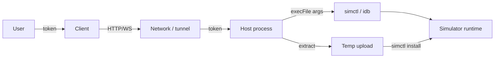

# Threat model

Method: STRIDE, scoped to a v0.1 deployment (one macOS host, a small number of trusted developers,
loopback or private network with an SSH tunnel).

## 1. Assets

| Asset                | Impact if compromised                                                    |
| -------------------- | ------------------------------------------------------------------------ |
| The Mac host         | Full code execution as the host user; access to Xcode, source, keychains |
| Simulator data       | App data, tokens, messages, screenshots, personal data                   |
| Uploaded app bundles | Code execution inside the simulator; possibly host-side tooling bugs     |
| Access token         | Control of all simulators on the host                                    |
| Screenshots/logs     | Disclosure of sensitive data                                             |
| Host filesystem      | Temp uploads, token file, client config                                  |

## 2. Actors

| Actor                   | Capability                                                | Trust                                                     |
| ----------------------- | --------------------------------------------------------- | --------------------------------------------------------- |
| Developer with token    | Full simulator control                                    | Trusted for simulator use, not necessarily for host shell |
| Developer without token | Can reach the port if exposed                             | Untrusted                                                 |
| Network attacker        | LAN/VPN sniffing, MITM                                    | Untrusted unless TLS/tunnel                               |
| Malicious app bundle    | Runs in the simulator; may exploit Apple/third-party code | Untrusted input                                           |
| Malicious dependency    | package supply chain                                      | Untrusted until reviewed                                  |
| Host operator           | Root/user on the Mac                                      | Trusted, but should be auditable                          |

## 3. Trust boundaries

Boundaries: user↔client, client↔network, network↔host, host↔Apple tools, upload↔filesystem,
host↔simulator. The host process is the most valuable boundary; it runs with the developer's
macOS user privileges.

## 4. STRIDE

| Threat                     | Example                                   | Mitigation                                                                  | Residual                                           |
| -------------------------- | ----------------------------------------- | --------------------------------------------------------------------------- | -------------------------------------------------- |
| **Spoofing**               | Attacker uses a leaked token              | Token 0600, rotation, SSH/TLS, no token in logs                             | Token theft is game over until rotated             |
| **Tampering**              | MITM modifies input/screenshot            | TLS/SSH; no integrity beyond transport                                      | Plain HTTP on LAN is tamperable                    |
| **Repudiation**            | User denies installing an app             | Host logs (Phase 2 audit); request IDs                                      | v0.1 logs are best-effort                          |
| **Information disclosure** | Screenshot/logs expose secrets            | Token-gated API; no public device data; retention policy                    | Authorized users see all simulator data            |
| **Denial of service**      | Many WS clients / large uploads           | FPS cap, backpressure, body limit, timeouts                                 | No per-IP rate limit in v0.1                       |
| **Elevation of privilege** | Upload path traversal / command injection | `execFile` args, temp dir, tar extraction, no shell                         | Apple tool bugs; malicious bundle inside simulator |
| **CSRF**                   | Browser on another origin calls API       | Bearer token not sent automatically; no permissive CORS; same-origin viewer | Token in URL can be used by anyone who sees it     |
| **XSS**                    | Viewer renders device names/logs          | `textContent`, no HTML injection; logs are text                             | Browser extensions can read DOM                    |
| **Supply chain**           | Malicious package/idb update              | Lockfile, pinned versions, review, bun audit                                | Upstream compromise                                |

## 5. Key threats in detail

### T1. Host exposed without auth

**Scenario:** `--bind 0.0.0.0 --no-auth` on a LAN; anyone can boot devices, install apps, read
screenshots.

**Mitigation:** the host refuses `--no-auth` on non-loopback binds. Token generation is on by
default. Docs push loopback + SSH tunnel. The firewall should restrict the port.

**Residual:** a user can still run the host with a token on a public interface; the tool cannot
enforce network policy.

### T2. Token leakage

**Scenario:** token in a URL pasted into chat, browser history, proxy logs, shell history, CI
logs.

**Mitigation:** token prompt in the viewer; `Authorization` header for REST; SSH tunnel; client
config mode 0600; docs warn about URL tokens. Phase 2 adds short-lived tokens and redaction.

**Residual:** v0.1 uses a long-lived shared secret. Treat it like a password.

### T3. Malicious app upload

**Scenario:** a tar contains `../../etc/...`, symlinks, a huge file, or a crafted `.app`.

**Mitigation:** upload is size-limited; `tar.x` extracts into a fresh temp directory with default
path protections; the host finds a `.app` and passes the path as an argument (no shell); the temp
dir is removed in `finally`.

**Residual:** a malicious app can exploit the simulator or Apple frameworks; the host does not
sandbox the simulator beyond Apple's own model. Only install apps you trust.

### T4. Command injection via UDID/bundle id/predicate

**Scenario:** a crafted UDID or predicate contains shell metacharacters.

**Mitigation:** all Apple tools are invoked with `execFile` and argument arrays; there is no
`shell: true`. Log values are length-capped. UDIDs are opaque strings passed as arguments.

**Residual:** `simctl`/`idb` may interpret unusual arguments; validation is minimal because UDIDs
are Apple-generated.

### T5. Denial of service

**Scenario:** many WebSocket clients each spawn `simctl screenshot` every 250 ms; host CPU/disk
saturates.

**Mitigation:** FPS cap, per-connection single-flight capture, 4 MiB backpressure, body limit,
HTTP timeouts. Phase 2 adds a shared per-device loop and rate limits.

**Residual:** v0.1 has no per-token quota; an authorized user can still load the host.

### T6. Cross-user data exposure

**Scenario:** two developers share one simulator and see each other's app data.

**Mitigation:** docs state v0.1 is single-user/small-team. Phase 3 adds leases/isolation.

**Residual:** shared simulator data is shared by design. Do not use a shared host for sensitive
data without isolation.

### T7. Transport interception

**Scenario:** plain HTTP on a LAN leaks the token and screenshots.

**Mitigation:** loopback default, SSH tunnel, TLS proxy guide.

**Residual:** no in-process TLS in v0.1; an operator can still choose HTTP over an untrusted
network.

## 6. Deployment checklist

- [ ] Token enabled; file mode 0600; not in shell history/CI logs.
- [ ] Bind loopback, or private interface + firewall + TLS.
- [ ] SSH tunnel for remote users; host key verified.
- [ ] No public unauthenticated port.
- [ ] macOS firewall enabled; only required clients.
- [ ] Host runs as a dedicated user if shared; full-disk access reviewed.
- [ ] Simulator data classified; retention policy documented.
- [ ] App uploads restricted to trusted artifacts; size limit reviewed.
- [ ] `idb`/package dependencies pinned and reviewed.
- [ ] Logs do not contain tokens; redaction checked.
- [ ] Incident procedure: stop host, rotate token, review access, notify.

## 7. Residual risk statement

For a single trusted developer on loopback or an SSH tunnel, the residual risk is comparable to
running `simctl` locally: the developer can already control the simulator and read its data. For a
shared host on a LAN, the main residual risks are token leakage, lack of per-user isolation, and
absence of rate limiting. Those are explicitly out of scope for v0.1 and tracked in the
[roadmap](../plans/roadmap.md).

## 8. Out of scope

- Compromise of the Mac's kernel or Apple's simulator.
- Malicious insiders with host shell access.
- Physical access attacks.
- Browser zero-days.
- Regulatory compliance certification (GDPR/HIPAA/etc.) — the operator must assess.

## 9. Review triggers

Re-run this threat model when:

- TLS or per-user tokens are added.
- Multi-tenancy or shared device leases are introduced.
- A new upload format is supported.
- A new Apple/Xcode version changes `simctl`/`idb` behaviour.
- The host is exposed beyond a private network.
